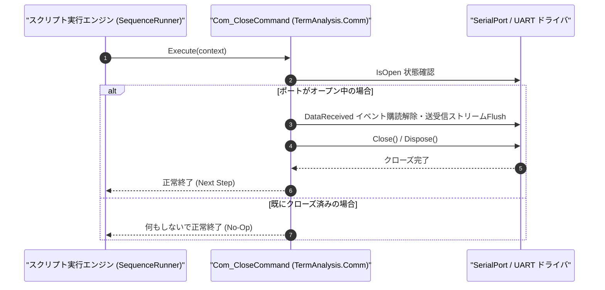

# コマンドリファレンス：Com_Close

---

## 概要

**Com_Close** は、現在オープンされている COM ポート（UART 回線）の非同期受信監視スレッドを安全に停止し、シリアルポートハンドルを解放・切断するコマンドです。

> 💡 **補足**: シーケンス終了時や通信テスト完了時に確実にポートを解放するために使用します。

---

## 💡 書式・パラメータ仕様

### コマンド構文

```csv
,SEQUENCE,Com_Close
```

### パラメータ（引数）一覧

| 引数位置 | パラメータ名 | 必須/任意 | 型・制約 | 説明 |
| :--- | :--- | :---: | :--- | :--- |
| （引数なし） | - | - | - | 現在接続中の COM ポートをクローズします。 |

---

## 🔄 特殊置換規約・分岐規約の適用

1. **引数なしコマンド**:
   - 引数を取らないため、特殊プレフィックス（`$` / `#` / `@`）による展開対象はありません。
2. **大文字・小文字の非区別（Case-Insensitive）**:
   - `Com_Close`、`COM_CLOSE`、`com_close` のいずれも同一コマンドとして実行されます。

---

## 💡 動作例（正しい構文での記述例）

### スクリプト記述例

```csv
; 1. COMポートを開いてステータスコマンドを送信
,SEQUENCE,Com_Open
,SEQUENCE,Com_Send, "STATUS?"
,SEQUENCE,Com_WaitPrompt, "OK", "3000"

; 2. 受信データをWork変数へ格納した後にCOMポートをクローズ
,SEQUENCE,Set_Data, "@RECV_LINE", "SBuf", "1"
,SEQUENCE,Com_Close
,SEQUENCE,Exit
```

### 実行時の挙動・変数変化

1. `Set_Data` により受信バッファ（`SBuf` / `TermRingBufferManager`）内の応答行が `@RECV_LINE` に取り込まれます。
2. `Com_Close` の実行によりシリアルポートの受信イベント購読が解除され、OS へ COM ポートハンドルが返却されます。

---

## 🔄 動作フロー（シーケンス図）



---

## 🚫 エラーハンドリング・安全設計（仕様制限）

1. **未接続時の安全な無視（No-Op 保証）**:
   - ポートがオープンされていない状態で `Com_Close` を実行してもエラーにはならず、安全に次のステップへ進みます。
2. **受信バッファ内データの保持**:
   - `Com_Close` を実行しても、すでに `TermRingBufferManager` に格納されている受信済みデータは即座に消去されず、後続の `Set_Data` や `Get_Line` で参照可能です（次回 `Com_Open` 時にクリアされます）。

---

## 🧪 ユニットテスト仕様

### テスト実行前提条件
- **対象クラス**: `TermAnalysis.Comm.Com_CloseCommand`（`Com_CloseCommand.cs`）
- **モック環境**: `ISerialPortAdapter` モックが注入されていること。

### テストケース一覧

| テストID | テスト観点 | 入力スクリプト | 期待される動作・検証項目 |
| :--- | :--- | :--- | :--- |
| `UT-COM-CLOSE-01` | 正常クローズ | `,SEQUENCE,Com_Close`（オープン中） | モックシリアルポートの `IsOpen` が `false` になり、ハンドルが解放されること。 |
| `UT-COM-CLOSE-02` | 未接続時の再クローズ | `,SEQUENCE,Com_Close`（未接続時） | 例外が発生せず、正常終了すること。 |

