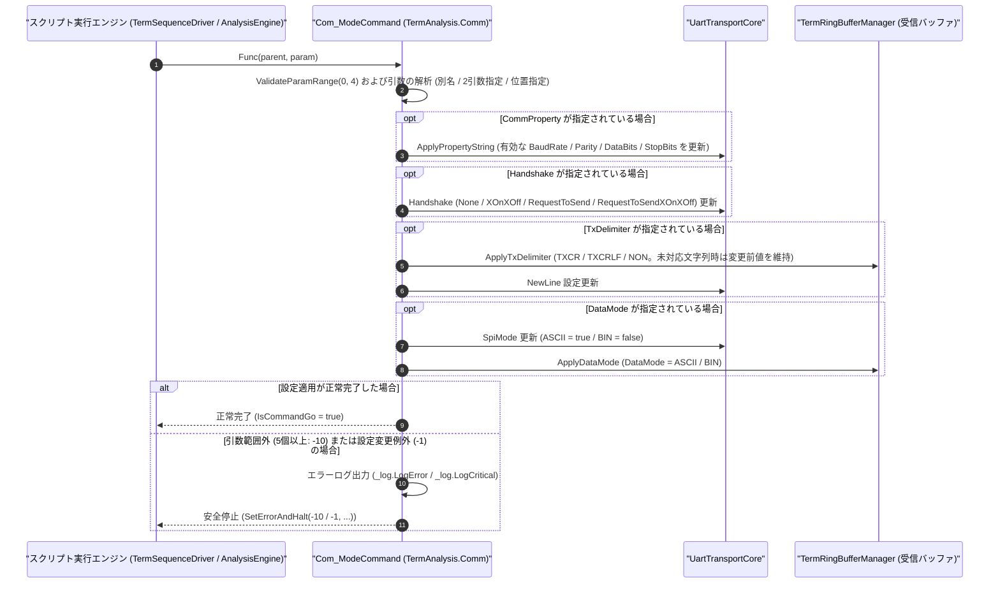

# コマンドリファレンス：Com_Mode

## 概要

**Com_Mode** は、COM ポート（UART）の通信プロパティ（ボーレート・パリティ・データビット・ストップビット）、フロー制御（ハンドシェイク）、送信デリミタ（`TXCR` / `TXCRLF` / `NON`）、および受信データモード（`ASCII` / `BIN`）を一括または個別に設定する統合モード制御コマンドです。

> 💡 **補足** : 旧コマンドの `Term_CommProperty`、`Term_Handshake`、`Term_TxCr`、`Term_TxCrLf`、`Term_Mode`（ASCII/BIN切替）を単一の体系へ統合したコマンドです。

---

## 💡 書式・パラメータ仕様

### コマンド構文

```csv
,SEQUENCE, [ステップキー], Com_Mode, "[CommPropertyOrSettingType]", "[HandshakeOrValue]", "[TxDelimiter]", "[DataMode]"
```

※ 上記の最大 4 引数による位置指定のほか、`Com_Mode, "<SettingType>", "<Value>"` の 2 引数キー指定形式（`PORT`, `PROPERTY` / `COMMPROPERTY`, `HANDSHAKE`, `LINEENDING` / `TXDELIMITER`, `SPI` / `DATAMODE`, `SELECTCOMMODE` / `MODE`）や、1 引数の自動判別ショートハンド記法にも対応しています。

### パラメータ（引数）一覧

| 引数位置 | パラメータ名 | 必須/任意 | 型・制約 | 説明 |
| :---: | :--- | :---: | :--- | :--- |
| 第1引数 | `CommProperty` | 任意 | `"Baud,Parity,DataBits,StopBits"`（例: `"9600,N,8,1"`） | UART 通信条件をカンマ区切り文字列で指定します。空文字 `""` または省略時は現在値を維持します。<br>※第 1 引数に単独キーワード（`"COM3"`, `"TXCR"`, `"TXCRLF"`, `"ASCII"`, `"BIN"` 等）を指定するショートハンド記法や、2 引数 `<SettingType>, <Value>` 形式にも対応しています。 |
| 第2引数 | `Handshake` | 任意 | `NONE` / `XONXOFF` / `RTSCTS` / `RTSXON`（`BOTH`） | ハードウェア／ソフトウェアフロー制御方式を指定します（`XON/XOFF`, `RTS/CTS`, `RTS`, `RTSXONXOFF` 等の表記も可。未定義文字列指定時は `NONE` となります）。空文字または省略時は現在値を維持します。 |
| 第3引数 | `TxDelimiter` | 任意 | `TXCR`（`CR`） / `TXCRLF`（`CRLF`） / `NON`（`NONE`） | `Com_Send` 等で自動付与する送信末改行コードを指定します。<br>※`"TXLF"` 等の未定義トークンを渡した場合、`TermRingBufferManager.ApplyTxDelimiter` では未対応（`false`）となるため `TermRingBufferManager.TxDelimiter` および `TermForm.TXCRLF` は変更前の値を維持し、位置指定または 2 引数指定時は `UartTransportCore.Shared.NewLine` のみが `\r`（CR）に設定されます（`UartTransportCore.Shared.NewLine` を `\n` にしたい場合は 2 引数形式 `Com_Mode, "LineEnding", "LF"` を使用するか、`Com_Send` 側の改行引数で `"LF"` を指定します）。 |
| 第4引数 | `DataMode` | 任意 | `ASCII`（`SPI_ON`） / `BIN`（`SPI_OFF`） | 受信リングバッファおよびログの解釈モードを指定します。<br>・`ASCII`: SPI フィルタが有効化され、`0x00` および `0xFF` を自動除外して有効テキストのみを蓄積します。<br>・`BIN`: フィルタを行わず、全バイトをそのままバイナリ透過受信します。 |

---

## 🔄 特殊置換規約・分岐規約の適用

本コマンドの引数における特殊記法および解釈ルールです。
* **動的置換（`$`）** : 引数内で `$PARAMキー$` のように記述すると、実行時に変数プール（PARAM）の値へ動的置換されます。（適用可能な引数: 全引数対応）
* **ジャンプ先指定（`#`）** : 本コマンドはジャンプ制御を行わないため適用されません。（適用可能な引数: 非適用）
* **共通コマンド指定（`@`）** : 本コマンドは外部マクロを呼び出さないため、共通コマンド呼び出し記法は適用されません。（適用可能な引数: 非適用）
* **カンマのエスケープ** : 通信条件文字列（例: `"9600,E,7,1"`）や複数データのカンマ区切り値を単一引数として渡す場合は、必ず `"..."` と二重引用符で囲んで記述します。
* **エイリアス（別名）** : `Port`, `Term_Port`, `Analysis_Term_Port`, `Property`, `Term_Propaty`, `Analysis_Term_Propaty`, `Handshake`, `Term_Handshak`, `Analysis_Term_Handshak`, `TXCR`, `Term_TXCR`, `Analysis_Term_TXCR`, `TXCRLF`, `Term_TXCRLF`, `Analysis_Term_TXCRLF`, `SPI_On`, `Term_SPI_On`, `Analysis_Term_SPI_On`, `ComAscii`, `SPI_Off`, `Term_SPI_Off`, `Analysis_Term_SPI_Off`, `ComBin`, `Select_Com_Mode`, `Analysis_Select_Com_Mode`

---

## 💡 動作例（正しい構文での記述例）

### スクリプト記述例

※COMMAND ブロック配下の子要素行（PARAM, SEQUENCE）は必ず行頭カンマから開始し、スペースインデントや行末コメント（`;`）は記述しないでください。

```csv
COMMAND, "SAMPLE_COM_MODE", ""
; 1. 全パラメータの一括初期設定（115200bps, Parity None, 8bit, Stop 1, RTS/CTS, CRLF, ASCII）
,SEQUENCE, 010, Com_Mode, "115200,N,8,1", "RTSCTS", "TXCRLF", "ASCII"
,SEQUENCE, 020, Com_Open
; 2. 通信中に送信デリミタのみを CR に変更（他は空文字で現在値維持）
,SEQUENCE, 030, Com_Mode, "", "", "TXCR", ""
,SEQUENCE, 040, Com_Send, "ATZ"
; 3. バイナリデータ受信のために受信モードを BIN、デリミタを NON に変更
,SEQUENCE, 050, Com_Mode, "", "", "NON", "BIN"
,SEQUENCE, 060, Com_Close
,SEQUENCE, 070, Exit
```

### 実行時の挙動・変数変化

* **実行前の状態** : Term 通信エンジンが初期化され、必要な通信パラメータおよび変数プール（`PARAM`）が準備されている状態。
* **実行後の状態** : 1 回目の `Com_Mode` で UART 通信条件・フロー制御・改行コード・データモードが一括設定されます。 2 回目の `Com_Mode` ではボーレートやフロー制御を維持したまま、送信デリミタのみが `CR`（`\r`）に切り替わります。 3 回目の `Com_Mode` では送信デリミタなし（`NON`）・バイナリ受信モード（`BIN`）に切り替わります。

---

## 🔄 動作フロー（シーケンス図）



---

## 🚫 エラーハンドリング・安全設計（仕様制限）

1. **不正な通信パラメータ指定時の現在値維持と安全なフォールバック** :
   - `CommProperty` に非数値または `0` 以下のボーレートが指定された場合は `ApplyCommPropertyString` が `false` を返し、`9600` bps へリセットすることなく **変更前の通信条件をそのまま維持** します。同様に、範囲外のデータビット（`5`〜`8` 以外または非整数）が指定された場合も `8` へリセットせず **変更前の `DataBits` を維持** します（一方、未定義のパリティ文字・ストップビット・ハンドシェイク文字列が指定された場合はそれぞれ `Parity.None` / `StopBits.One` / `Handshake.None` へ安全にフォールバックし、`"TXLF"` 等の未定義送信デリミタ指定時は `TermRingBufferManager.TxDelimiter` および `TermForm.TXCRLF` が変更前値を維持しつつ `UartTransportCore.Shared.NewLine` が `"\r"` となります）。
2. **引数個数境界ガードおよびオープン中の動的変更保護** :
   - 5 個以上の引数が渡された場合は `ValidateParamRange(0, 4)` によりエラーコード `-10` で安全停止します。またポートオープン中にボーレート等を変更した際、OS ドライバ側で例外が発生した場合は `SetErrorAndHalt(-1, ex.Message)` により安全に停止します。

---

## 🧪 ユニットテスト仕様

本コマンドクラス（`Com_ModeCommand.cs`）に実装されている `RunUnitTest()` メソッドが検証するユニットテストの仕様です。

### テスト実行前提条件

* **実行トリガー** : `RunUnitTest()` メソッドの呼び出し
* **有効化条件** : システム全体の最小ログレベル（`ErrorLogger.MinimumLevel`）が `LogLevel.Test` であること（それ以外の場合は無効化ガードにより早期リターン）
* **検証結果出力** : `_log.LogTest` によるログ出力。検証失敗時は `_log.LogError`、予期せぬ例外発生時は `_log.LogCritical` で記録し、`finally` ブロックで `ApplySetting` により `"Property"`=`"9600,N,8,1"`、`"Handshake"`=`"None"`、`"LineEnding"`=`"CR"`、`"SPI"`=`"Off"` へ初期状態を復元します。

### テストケース一覧

| No | テストカテゴリ | テスト条件（入力値） | 期待される結果（出力値） | 検証の目的 / 観点 |
| :---: | :--- | :--- | :--- | :--- |
| **1** | 正常系 | 引数 `"38400,O,7,2"`, `"RtsCts"`, `"TXCRLF"`, `"ASCII"` の 4 引数一括設定を指定して `Func(null, param)` を実行 | `!param.HasError` かつ `BaudRate == 38400`、`Parity == Parity.Odd`、`DataBits == 7`、`StopBits == StopBits.Two`、`Handshake == Handshake.RequestToSend`、`NewLine == "\r\n"`、`SpiMode == true` となる | 通信プロパティ・フロー制御・送信デリミタ・ASCII（SPI）モードの一括反映検証 |
| **2** | 異常系 | 過剰引数 5 個（`"9600,N,8,1"`, `"None"`, `"TXCR"`, `"ASCII"`, `"EXTRA_INVALID"`）を指定して `Func(null, invalidParam)` を実行 | `invalidParam.HasError == true` かつ `!invalidParam.IsCommandGo` となり安全に拒否・停止する | 引数上限（`ValidateParamRange(0, 4)`）違反時の境界防御検証 |
