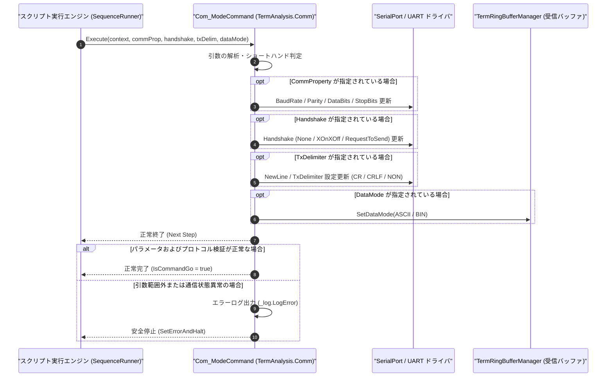

# コマンドリファレンス：Com_Mode

## 概要

**Com_Mode** は、COM ポート（UART）の通信プロパティ（ボーレート・パリティ・データビット・ストップビット）、フロー制御（ハンドシェイク）、送信デリミタ（`TXCR` / `TXCRLF` / `NON`）、および受信データモード（`ASCII` / `BIN`）を一括または個別に設定する統合モード制御コマンドです。

> 💡 **補足**: 旧コマンドの `Term_CommProperty`、`Term_Handshake`、`Term_TxCr`、`Term_TxCrLf`、`Term_Mode`（ASCII/BIN切替）を単一の体系へ統合したコマンドです。

---

## 💡 書式・パラメータ仕様

### コマンド構文

```csv
,SEQUENCE, [ステップキー], Com_Mode, "[CommProperty]", "[Handshake]", "[TxDelimiter]", "[DataMode]"
```

### パラメータ（引数）一覧

| 引数位置 | パラメータ名 | 必須/任意 | 型・制約 | 説明 |
| :---: | :--- | :---: | :--- | :--- |
| 第1引数 | `CommProperty` | 任意 | `"Baud,Parity,DataBits,StopBits"`（例: `"9600,N,8,1"`） | UART 通信条件をカンマ区切り文字列で指定します。空文字 `""` または省略時は現在値を維持します。<br>※第1引数に単独キーワード（`"TXCR"`, `"ASCII"`, `"BIN"` 等）を指定するショートハンド記法にも対応しています。 |
| 第2引数 | `Handshake` | 任意 | `NONE` / `XONXOFF` / `RTSCTS` / `DTRDSR` | ハードウェア／ソフトウェアフロー制御方式を指定します。空文字または省略時は現在値を維持します。 |
| 第3引数 | `TxDelimiter` | 任意 | `TXCR` / `TXCRLF` / `TXLF` / `NON` | `Com_Send` 等で自動付与する送信末改行コードを指定します。 |
| 第4引数 | `DataMode` | 任意 | `ASCII` / `BIN` | 受信リングバッファおよびログの解釈モードを指定します。<br>・`ASCII`: SPI フィルタが有効化され、`0x00` および `0xFF` を自動除外して有効テキストのみを蓄積します。<br>・`BIN`: フィルタを行わず、全バイトをそのままバイナリ透過受信します。 |

---

## 🔄 特殊置換規約・分岐規約の適用

本コマンドの引数における特殊記法および解釈ルールです。
* **動的置換（`$`）**: 引数内で `$PARAMキー$` のように記述すると、実行時に変数プール（PARAM）の値へ動的置換されます。（適用可能な引数: 全引数対応）
* **ジャンプ先指定（`#`）**: 本コマンドはジャンプ制御を行わないため適用されません。（適用可能な引数: 非適用）
* **共通コマンド指定（`@`）**: 本コマンドは外部マクロを呼び出さないため、共通コマンド呼び出し記法は適用されません。（適用可能な引数: 非適用）
* **カンマのエスケープ**: 通信条件文字列（例: `"9600,E,7,1"`）や複数データのカンマ区切り値を単一引数として渡す場合は、必ず `"..."` と二重引用符で囲んで記述します。
* **エイリアス（別名）**: `Port`, `Term_Port`, `Property`, `Term_Propaty`, `Handshake`, `Term_Handshak`, `TXCR`, `TXCRLF`, `SPI_On`, `ComAscii`, `SPI_Off`, `ComBin`, `Select_Com_Mode`

---

## 💡 動作例（正しい構文での記述例）

### スクリプト記述例

※COMMAND ブロック配下の子要素行（PARAM, SEQUENCE）は必ず行頭カンマから開始し、スペースインデントや行末コメント（`;`）は記述しないでください。

```csv
COMMAND, "SAMPLE_COM_MODE", ""
; 1. 全パラメータの一括初期設定（115200bps, Parity None, 8bit, Stop 1, RTS/CTS, CRLF, ASCII）
,SEQUENCE, 010, Com_Mode, "115200,N,8,1", "RTSCTS", "TXCRLF", "ASCII"
,SEQUENCE, 020, Com_Open
; 2. 通信中に送信デリミタのみを CR に変更（他は空文字で現在値維持）
,SEQUENCE, 030, Com_Mode, "", "", "TXCR", ""
,SEQUENCE, 040, Com_Send, "ATZ"
; 3. バイナリデータ受信のために受信モードを BIN、デリミタを NON に変更
,SEQUENCE, 050, Com_Mode, "", "", "NON", "BIN"
,SEQUENCE, 060, Com_Close
,SEQUENCE, 070, Exit
```

### 実行時の挙動・変数変化

* **実行前の状態**: Term 通信エンジンが初期化され、必要な通信パラメータおよび変数プール（`PARAM`）が準備されている状態。
* **実行後の状態**: 1 回目の `Com_Mode` で UART 通信条件・フロー制御・改行コード・データモードが一括設定されます。 2 回目の `Com_Mode` ではボーレートやフロー制御を維持したまま、送信デリミタのみが `CR`（`\r`）に切り替わります。 3 回目の `Com_Mode` では送信デリミタなし（`NON`）・バイナリ受信モード（`BIN`）に切り替わります。

---

## 🔄 動作フロー（シーケンス図）



---

## 🚫 エラーハンドリング・安全設計（仕様制限）

1. **不正な通信パラメータの検証**:
   - 未定義のボーレート（負数や非数値）や不正なパリティ文字（`N`, `E`, `O`, `M`, `S` 以外）が指定された場合は、`ArgumentException` を送出して誤設定を防止します。
2. **オープン中の通信条件動的変更**:
   - ポートオープン中にボーレート等を変更した場合、OS ドライバに対してリアルタイムにプロパティ反映を行います。

---

## 🧪 ユニットテスト仕様

本コマンドクラス（`Com_ModeCommand.cs`）に実装されている `RunUnitTest()` メソッドが検証するユニットテストの仕様です。

### テスト実行前提条件

* **実行トリガー**: `RunUnitTest()` メソッドの呼び出し
* **有効化条件**: システム全体の最小ログレベル（`ErrorLogger.MinimumLevel`）が `LogLevel.Test` であること（それ以外の場合は無効化ガードにより早期リターン）
* **検証結果出力**: `_log.LogTest` によるログ出力。検証失敗時は `_log.LogError`、予期せぬ例外発生時は `_log.LogCritical` で記録し、`finally` ブロックで `ApplySetting` により `"Property"`=`"9600,N,8,1"`、`"Handshake"`=`"None"`、`"LineEnding"`=`"CR"`、`"SPI"`=`"Off"` へ初期状態を復元します。

### テストケース一覧

| No | テストカテゴリ | テスト条件（入力値） | 期待される結果（出力値） | 検証の目的 / 観点 |
| :---: | :--- | :--- | :--- | :--- |
| **1** | 正常系 | 引数 `"38400,O,7,2"`, `"RtsCts"`, `"TXCRLF"`, `"ASCII"` の 4 引数一括設定を指定して実行 | `!param.HasError` かつ `BaudRate == 38400`、`Parity == Parity.Odd`、`DataBits == 7`、`StopBits == StopBits.Two`、`Handshake == Handshake.RequestToSend`、`NewLine == "\r\n"`、`SpiMode == true` となる | 通信プロパティ・フロー制御・送信デリミタ・ASCII（SPI）モードの一括反映検証 |
| **2** | 異常系 | 引数 5 個以上の過剰指定（`ValidateParamRange(0, 4)` 違反）または設定適用中の例外発生 | 引数範囲外エラーによる早期リターン、または `_log.LogCritical` 記録と `SetErrorAndHalt(-1, ex.Message)` による安全停止 | 引数個数境界ガードおよび設定変更例外時のフェイルセーフ検証 |
