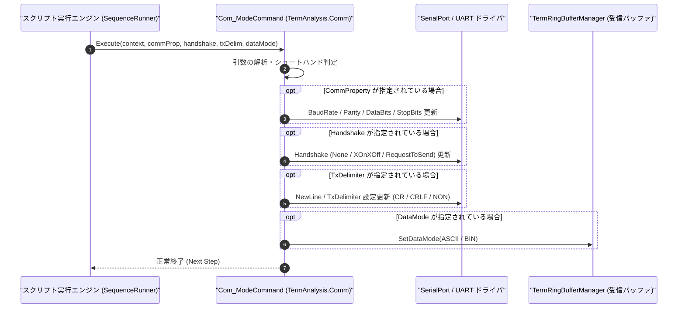

# コマンドリファレンス：Com_Mode

---

## 概要

**Com_Mode** は、COM ポート（UART）の通信プロパティ（ボーレート・パリティ・データビット・ストップビット）、フロー制御（ハンドシェイク）、送信デリミタ（`TXCR` / `TXCRLF` / `NON`）、および受信データモード（`ASCII` / `BIN`）を一括または個別に設定する統合モード制御コマンドです。

> 💡 **補足**: 旧コマンドの `Term_CommProperty`、`Term_Handshake`、`Term_TxCr`、`Term_TxCrLf`、`Term_Mode`（ASCII/BIN切替）を単一の体系へ統合したコマンドです。

---

## 💡 書式・パラメータ仕様

### コマンド構文

```csv
,SEQUENCE,Com_Mode, "[CommProperty]", "[Handshake]", "[TxDelimiter]", "[DataMode]"
```

### パラメータ（引数）一覧

| 引数位置 | パラメータ名 | 必須/任意 | 型・制約 | 説明 |
| :---: | :--- | :---: | :--- | :--- |
| 第1引数 | `CommProperty` | 任意 | `"Baud,Parity,DataBits,StopBits"`（例: `"9600,N,8,1"`） | UART 通信条件をカンマ区切り文字列で指定します。空文字 `""` または省略時は現在値を維持します。<br>※第1引数に単独キーワード（`"TXCR"`, `"ASCII"`, `"BIN"` 等）を指定するショートハンド記法にも対応しています。 |
| 第2引数 | `Handshake` | 任意 | `NONE` / `XONXOFF` / `RTSCTS` / `DTRDSR` | ハードウェア／ソフトウェアフロー制御方式を指定します。空文字または省略時は現在値を維持します。 |
| 第3引数 | `TxDelimiter` | 任意 | `TXCR` / `TXCRLF` / `TXLF` / `NON` | `Com_Send` 等で自動付与する送信末改行コードを指定します。 |
| 第4引数 | `DataMode` | 任意 | `ASCII` / `BIN` | 受信リングバッファおよびログの解釈モードを指定します。<br>・`ASCII`: SPI フィルタが有効化され、`0x00` および `0xFF` を自動除外して有効テキストのみを蓄積します。<br>・`BIN`: フィルタを行わず、全バイトをそのままバイナリ透過受信します。 |

---

## 🔄 特殊置換規約・分岐規約の適用

1. **カンマを含む第1引数の保護**:
   - `"115200,E,8,1"` のようにカンマを含む通信条件文字列は、必ずダブルクォーテーション `""` で囲んで記述します。
2. **部分更新（省略または空文字 `""` の維持仕様）**:
   - 変更したい項目のみを指定し、他の引数を省略または `""` とすることで、既存の通信設定を壊さずに特定のモード（送信デリミタのみ等）だけを動的に切り替えられます。
3. **レガシー別名互換**:
   - 旧表記の `Term_CommProperty`、`Term_Handshake`、`Term_TxCr`、`Term_TxCrLf`、`Term_Mode` は内部正規化により本コマンドへ統合処理されます。
4. **DataMode (`ASCII` / `BIN`) と SPI フィルタリング動作**:
   - **`ASCII` モード**: 受信バイトストリームをリングバッファへ投入する際、ヌルバイト（`0x00`）および未通信・アイドリングバイト（`0xFF`）を自動的に除外（SPI フィルタ）します。SPI バスや UART 経由で発生する無効ダミー文字を排除し、純粋なテキスト文字列のみを行バッファへ蓄積して解析できるようにします。
   - **`BIN` モード**: フィルタリングを行わず、受信した全バイト（`0x00` や `0xFF` を含む）をそのまま生バイナリデータとして透過的にリングバッファへ蓄積します。バイナリ通信やパケット送受信を行う場合に指定します。

---

## 💡 動作例（正しい構文での記述例）

### スクリプト記述例

```csv
; 1. 全パラメータの一括初期設定（115200bps, Parity None, 8bit, Stop 1, RTS/CTS, CRLF, ASCII）
,SEQUENCE,Com_Mode, "115200,N,8,1", "RTSCTS", "TXCRLF", "ASCII"
,SEQUENCE,Com_Open

; 2. 通信中に送信デリミタのみを CR に変更（他は空文字で現在値維持）
,SEQUENCE,Com_Mode, "", "", "TXCR", ""
,SEQUENCE,Com_Send, "ATZ"

; 3. バイナリデータ受信のために受信モードを BIN、デリミタを NON に変更
,SEQUENCE,Com_Mode, "", "", "NON", "BIN"
,SEQUENCE,Com_Close
,SEQUENCE,Exit
```

### 実行時の挙動・変数変化

1. 1 回目の `Com_Mode` で UART 通信条件・フロー制御・改行コード・データモードが一括設定されます。
2. 2 回目の `Com_Mode` ではボーレートやフロー制御を維持したまま、送信デリミタのみが `CR`（`\r`）に切り替わります。
3. 3 回目の `Com_Mode` では送信デリミタなし（`NON`）・バイナリ受信モード（`BIN`）に切り替わります。

---

## 🔄 動作フロー（シーケンス図）



---

## 🚫 エラーハンドリング・安全設計（仕様制限）

1. **不正な通信パラメータの検証**:
   - 未定義のボーレート（負数や非数値）や不正なパリティ文字（`N`, `E`, `O`, `M`, `S` 以外）が指定された場合は、`ArgumentException` を送出して誤設定を防止します。
2. **オープン中の通信条件動的変更**:
   - ポートオープン中にボーレート等を変更した場合、OS ドライバに対してリアルタイムにプロパティ反映を行います。

---

## 🧪 ユニットテスト仕様

### テスト実行前提条件
- **対象クラス**: `TermAnalysis.Comm.Com_ModeCommand`（`Com_ModeCommand.cs`）
- **モック環境**: `ISerialPortAdapter` モックおよび `TermRingBufferManager` が注入されていること。

### テストケース一覧

| テストID | テスト観点 | 入力スクリプト | 期待される動作・検証項目 |
| :--- | :--- | :--- | :--- |
| `UT-COM-MODE-01` | 全項目一括設定 | `,SEQUENCE,Com_Mode, "9600,E,7,1", "XONXOFF", "TXCRLF", "ASCII"` | ボーレート 9600、偶数パリティ、7bit、Stop 1、XON/XOFF、CRLF、ASCII が正しく設定されること。 |
| `UT-COM-MODE-02` | 部分更新（デリミタのみ） | `,SEQUENCE,Com_Mode, "", "", "TXCR", ""` | 既存のボーレート等を維持したまま、送信デリミタのみが `CR` に変更されること。 |
| `UT-COM-MODE-03` | 異常系（書式不正） | `,SEQUENCE,Com_Mode, "INVALID_BAUD,N,8,1"` | `ArgumentException` が送出され、エラーログが出力されること。 |

