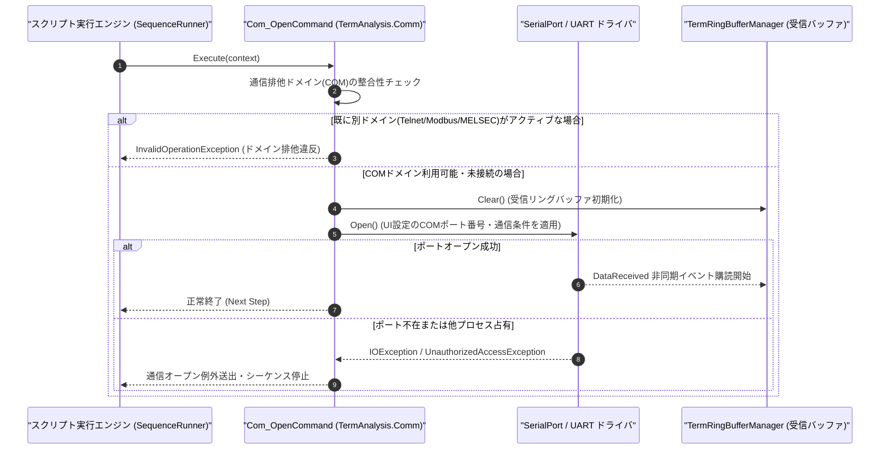

# コマンドリファレンス：Com_Open

---

## 概要

**Com_Open** は、Term アプリケーションの UI 画面または環境設定ファイルであらかじめ設定された COM ポート（UART / シリアル通信ポート）をオープンし、非同期受信監視スレッドおよび受信リングバッファ（`TermRingBufferManager`）の稼働を開始するコマンドです。
実行時に Term 通信制御の排他選択モードを **COM（UART）モード**（`TermAnalysis.Comm.dll`）へ確定させます。

> 💡 **補足**: 使用する COM ポート番号は PC 環境に依存するため、ミニシーケンスの引数では指定せず UI 設定値（環境設定）から自動取得します。物理 COM ポート（RS-232C / USB-シリアル変換器）に加え、公式無償ツール **[c2c](https://github.com/Monaca-App/c2c)** が公開中の仮想 COM ポート（例: `COM10` ⇔ `COM11`）も透過的にオープン可能です。

---

## 💡 書式・パラメータ仕様

### コマンド構文

```csv
,SEQUENCE,Com_Open
```

### パラメータ（引数）一覧

| 引数位置 | パラメータ名 | 必須/任意 | 型・制約 | 説明 |
| :--- | :--- | :---: | :--- | :--- |
| （引数なし） | - | - | - | UI 上で選択されている COM ポート番号および現在の通信条件を使用して回線をオープンします。 |

---

## 🔄 特殊置換規約・分岐規約の適用

1. **引数なしコマンド**:
   - 引数を取らないため、変数展開（`$` / `#` / `@`）は使用しません。
2. **大文字・小文字の非区別（Case-Insensitive）**:
   - スクリプト記述時は `Com_Open`、`COM_OPEN`、`com_open` のいずれも同一コマンドとして正規化されます。
3. **排他ドメインの確定**:
   - 本コマンド実行以降、セッション内の通信プロトコルは COM（UART）に固定され、Telnet / Modbus / MELSEC コマンドとの混在実行は排他制御によりブロックされます。

---

## 💡 動作例（正しい構文での記述例）

### スクリプト記述例

```csv
; 1. 通信条件・デリミタ・データモードを事前設定してからCOMポートをオープン
,SEQUENCE,Com_Mode, "9600,N,8,1", "NONE", "TXCRLF", "ASCII"
,SEQUENCE,Com_Open

; 2. 機器の初期化コマンド送信とプロンプト待機
,SEQUENCE,Com_Send, "INIT"
,SEQUENCE,Com_WaitPrompt, "READY>", "5000", "ERROR_TIMEOUT"
,SEQUENCE,Exit
```

### 実行時の挙動・変数変化

1. `Com_Mode` によりボーレート `9600`、パリティ `None`、データビット `8`、ストップビット `1`、フロー制御なし、送信改行 `CR+LF`、ASCII モードが設定されます。
2. `Com_Open` により UI で指定された COM ポートが開かれ、`TermRingBufferManager` へのバックグラウンド非同期受信タスクが開始されます。

---

## 🔄 動作フロー（シーケンス図）



---

## 🚫 エラーハンドリング・安全設計（仕様制限）

1. **二重オープンの安全な扱い（Idempotent 制御）**:
   - すでに同一 COM ポートがオープンされている状態で `Com_Open` が再実行された場合、既存接続を安全に維持するか再初期化してエラーとせず継続します。
2. **ポート不在・アクセス拒否時の例外通知**:
   - 指定された COM ポートが存在しない場合や他アプリケーションが使用中の場合は、詳細なポート名を含むエラーログを出力してシーケンスを安全に停止します。
3. **他通信ドメインとの排他保護**:
   - 同一シーケンス内で `Telnet_Open` や `Modbus_Open` 等と併用された場合は、排他制御エラーとして即座に検出・遮断します。

---

## 🧪 ユニットテスト仕様

### テスト実行前提条件
- **対象クラス**: `TermAnalysis.Comm.Com_OpenCommand`（`Com_OpenCommand.cs`）
- **モック環境**: `ISerialPortAdapter` モックおよび `TermRingBufferManager` インスタンスが注入されていること。

### テストケース一覧

| テストID | テスト観点 | 入力スクリプト | 期待される動作・検証項目 |
| :--- | :--- | :--- | :--- |
| `UT-COM-OPEN-01` | 正常オープン | `,SEQUENCE,Com_Open` | モックシリアルポートの `IsOpen` が `true` になり、受信バッファがクリアされて監視が開始されること。 |
| `UT-COM-OPEN-02` | 大文字小文字非区別 | `,SEQUENCE,com_open` | `Com_OpenCommand` が正常に呼び出され、ポートがオープンされること。 |
| `UT-COM-OPEN-03` | 異常系（ポート不在） | `,SEQUENCE,Com_Open`（未接続ポート設定時） | ポートオープン失敗例外が捕捉され、エラーメッセージがログ出力されて停止すること。 |

