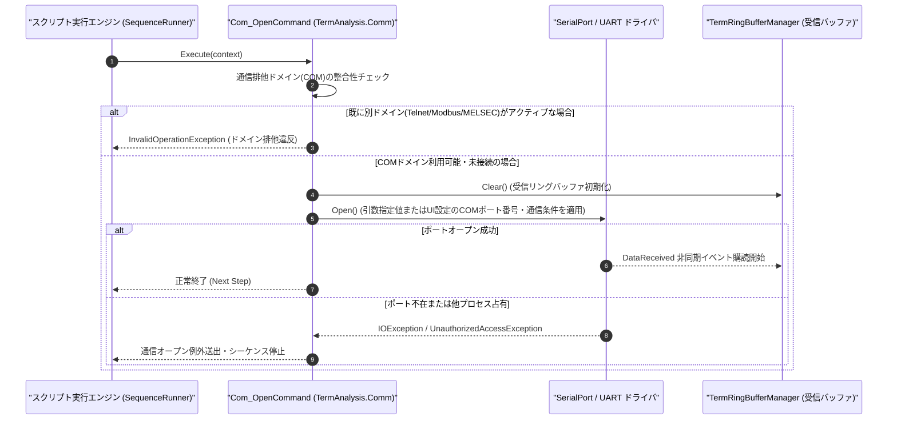

# コマンドリファレンス：Com_Open

## 概要

**Com_Open** は、COM ポート（UART / シリアル通信ポート）をオープンし、非同期受信監視スレッドおよび受信リングバッファ（`TermRingBufferManager`）の稼働を開始する通信制御系コマンドです。引数を省略した場合はプロパティ設定画面の環境設定値を自動採用し、引数を指定した場合は個別通信条件（`PortName`〜`StopBits`）でオーバーライド可能です。
実行時に Term 通信制御の排他選択モードを **COM（UART）モード** （`TermAnalysis.Comm.dll`）へ確定させます。

> 💡 **補足**: 引数をすべて省略した場合はプロパティ設定画面（環境設定）の COM ポート番号・通信条件を自動採用し、第 1 引数〜第 5 引数を指定した場合はスクリプト側から個別通信条件（`PortName`〜`StopBits`）でオーバーライドしてオープンできます。物理 COM ポート（RS-232C / USB-シリアル変換器）に加え、仮想シリアル中継ツール **[c2c](https://github.com/Monaca-App/c2c)** が公開中の仮想 COM ポート（例: `COM10` ⇔ `COM11`）も透過的にオープン可能です。

---

## 💡 書式・パラメータ仕様

### コマンド構文

```csv
,SEQUENCE, [ステップキー], Com_Open, "[PortName]", "[BaudRate: 9600]", "[Parity: None]", "[DataBits: 8]", "[StopBits: 1]"
```

※ 全引数を省略した場合は、UI プロパティ画面または `Com_Mode` で設定されている現在の通信条件を使用して COM ポートをオープンします。

### パラメータ（引数）一覧

| 引数位置 | 引数名 | 必須/任意 | 説明・制約 |
| :--- | :--- | :---: | :--- |
| 第 1 引数 | `PortName` | 任意 | オープンする COM ポート名（例: `"COM3"`、省略時既定値: `""`＝UI 設定ポートを使用）。 |
| 第 2 引数 | `BaudRate` | 任意 | 通信ボーレート［bps］（`300` 以上の整数、省略時既定値: `9600`）。 |
| 第 3 引数 | `Parity` | 任意 | パリティ種別（`"None"` / `"Even"` / `"Odd"` / `"Mark"` / `"Space"`、省略時既定値: `"None"`）。 |
| 第 4 引数 | `DataBits` | 任意 | データビット長（`5`〜`8`、省略時既定値: `8`）。 |
| 第 5 引数 | `StopBits` | 任意 | ストップビット長（`"1"` / `"1.5"` / `"2"`、省略時既定値: `"1"`）。 |

---

## 🔄 特殊置換規約・分岐規約の適用

本コマンドの引数における特殊記法および解釈ルールです。
* **動的置換（`$`）**: 引数内で `$PARAMキー$` のように記述すると、実行時に変数プール（PARAM）の値へ動的置換されます。（適用可能な引数: 全引数対応）
* **ジャンプ先指定（`#`）**: 本コマンドはジャンプ制御を行わないため適用されません。（適用可能な引数: 非適用）
* **共通コマンド指定（`@`）**: 本コマンドは外部マクロを呼び出さないため、共通コマンド呼び出し記法は適用されません。（適用可能な引数: 非適用）
* **カンマのエスケープ**: 通信条件文字列（例: `"9600,E,7,1"`）や複数データのカンマ区切り値を単一引数として渡す場合は、必ず `"..."` と二重引用符で囲んで記述します。
* **エイリアス（別名）**: `Open`, `Term_Open`, `Analysis_Term_Open`

---

## 💡 動作例（正しい構文での記述例）

### スクリプト記述例

※COMMAND ブロック配下の子要素行（PARAM, SEQUENCE）は必ず行頭カンマから開始し、スペースインデントや行末コメント（`;`）は記述しないでください。

```csv
COMMAND, "SAMPLE_COM_OPEN", ""
; 1. 通信条件・デリミタ・データモードを事前設定してからCOMポートをオープン
,SEQUENCE, 010, Com_Mode, "9600,N,8,1", "NONE", "TXCRLF", "ASCII"
,SEQUENCE, 020, Com_Open
; 2. 機器の初期化コマンド送信とプロンプト待機
,SEQUENCE, 030, Com_Send, "INIT"
,SEQUENCE, 040, Com_WaitPrompt, "READY>", "5000", "ERROR_TIMEOUT"
,SEQUENCE, 050, Exit
```

### 実行時の挙動・変数変化

* **実行前の状態**: Term 通信エンジンが初期化され、必要な通信パラメータおよび変数プール（`PARAM`）が準備されている状態。
* **実行後の状態**: `Com_Mode` によりボーレート `9600`、パリティ `None`、データビット `8`、ストップビット `1`、フロー制御なし、送信改行 `CR+LF`、ASCII モードが設定されます。 `Com_Open` により UI で指定された COM ポートが開かれ、`TermRingBufferManager` へのバックグラウンド非同期受信タスクが開始されます。

---

## 🔄 動作フロー（シーケンス図）



---

## 🚫 エラーハンドリング・安全設計（仕様制限）

1. **二重オープンの安全な扱い（Idempotent 制御）**:
   - すでに同一 COM ポートがオープンされている状態で `Com_Open` が再実行された場合、既存接続を安全に維持するか再初期化してエラーとせず継続します。
2. **ポート不在・アクセス拒否時の例外通知**:
   - 指定された COM ポートが存在しない場合や他アプリケーションが使用中の場合は、詳細なポート名を含むエラーログを出力してシーケンスを安全に停止します。
3. **他通信ドメインとの排他保護**:
   - 同一シーケンス内で `Telnet_Open` や `Modbus_Open` 等と併用された場合は、排他制御エラーとして即座に検出・遮断します。

---

## 🧪 ユニットテスト仕様

本コマンドクラス（`Com_OpenCommand.cs`）に実装されている `RunUnitTest()` メソッドが検証するユニットテストの仕様です。

### テスト実行前提条件

* **実行トリガー**: `RunUnitTest()` メソッドの呼び出し
* **有効化条件**: システム全体の最小ログレベル（`ErrorLogger.MinimumLevel`）が `LogLevel.Test` であること（それ以外の場合は無効化ガードにより早期リターン）
* **検証結果出力**: `_log.LogTest` によるログ出力。検証失敗時は `_log.LogError`、予期せぬ例外発生時は `_log.LogCritical` で記録し、`finally` ブロックで `TermRingBufferManager.Instance.CloseSession(TermTransportDomain.Com, null)` および `UartTransportCore.Shared.IsSimulationMode` の復元（UI タブ検証時は `TabControl?.Dispose()` と一時設定 `"TermUnitTest_TempComOpen"` の削除）を実行します。

### テストケース一覧

| No | テストカテゴリ | テスト条件（入力値） | 期待される結果（出力値） | 検証の目的 / 観点 |
| :---: | :--- | :--- | :--- | :--- |
| **1** | 正常系 | `IsSimulationMode = true` 環境下で引数 `"COM3"`, `"115200"`, `"Even"`, `"8"`, `"1"` を指定して実行 | `!param.HasError` かつ `IsOpen == true`、`ActiveDomain == TermTransportDomain.Com`、`PortName == "COM3"`、`BaudRate == 115200`、`Parity == Parity.Even` となる | 個別通信条件オーバーライドおよび COM 排他セッション確立の検証 |
| **2** | 異常系 | セッション切断後、`IsSimulationMode = false` 環境下で存在しない物理ポート `"COM254"`, `"9600"` を指定して実行 | `failParam.HasError == true`、`!failParam.IsCommandGo`、`!IsOpen`、`ActiveDomain == TermTransportDomain.None` となり、`LastErrorMessage` にエラー内容が格納される | 存在しない物理 COM ポート指定時のオープン失敗検出と安全停止の検証 |
| **3** | 正常系 | `TermPropertiesCom`（一時設定 `"TermUnitTest_TempComOpen"`）で `"COM1"` 表示後、未接続ポート `"COM254"` と `"115200,N,8,1"` を設定 | `comTab.CommPort` が `"COM1"` へ巻き戻らず `"COM254"` のまま保持される | UI プロパティタブにおける未接続ポート名保持動作の検証 |
