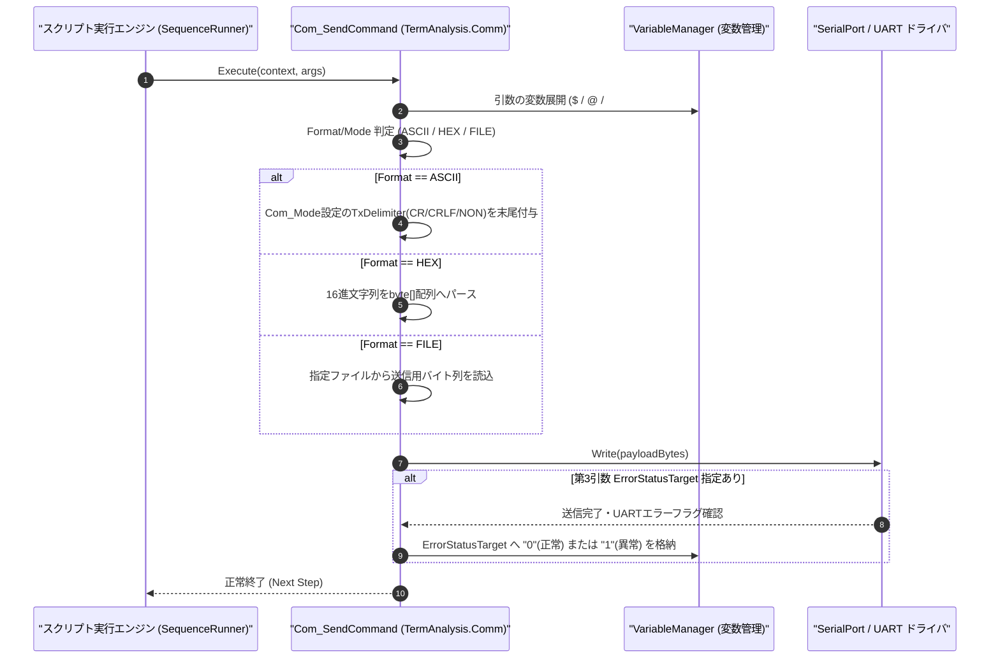

# コマンドリファレンス：Com_Send

## 概要

**Com_Send** は、オープン中の COM ポート（UART）に対して文字列メッセージ、16 進バイト列（HEX）、または指定ファイルの内容を送信するコマンドです。
第 3 引数にステータス格納先変数を指定することで、通信エラーフラグ（パリティエラー・フレーミングエラー・タイムアウト等）の監視を伴うエラー確認付き送信（旧 `Term_Send_ER` 相当）としても動作します。

> 💡 **補足**: `Com_Mode` で設定された送信デリミタ（`TXCR` / `TXCRLF` / `NON`）が送信データ末尾に自動付与されます。

---

## 💡 書式・パラメータ仕様

### コマンド構文

```csv
,SEQUENCE, [ステップキー], Com_Send, "<Message/FilePath>", "[Format/Mode]", "[ErrorStatusTarget]"
```

### パラメータ（引数）一覧

| 引数位置 | パラメータ名 | 必須/任意 | 型・制約 | 説明 |
| :---: | :--- | :---: | :--- | :--- |
| 第1引数 | `Message/FilePath` | **必須** | 文字列 | 送信する文字列データ、16進文字列、または送信対象ファイルのパスを指定します。 |
| 第2引数 | `Format/Mode` | 任意 | `ASCII` / `HEX` / `FILE`（既定値: `ASCII`） | 送信データの解釈モードを指定します。<br>・`ASCII`: テキスト文字列として送信（デリミタ自動付与）<br>・`HEX`: 16進文字列（例: `"02 41 42 03"`）をバイナリ変換して送信<br>・`FILE`: 第1引数をファイルパスとして読み込み送信 |
| 第3引数 | `ErrorStatusTarget` | 任意 | 変数名（`$` / `@`） | 送信時の通信エラー判定結果（`"0"`: 正常 / `"1"`: エラー発生）を格納する変数名を指定します。 |

---

## 🔄 特殊置換規約・分岐規約の適用

本コマンドの引数における特殊記法および解釈ルールです。
* **動的置換（`$`）**: 引数内で `$PARAMキー$` のように記述すると、実行時に変数プール（PARAM）の値へ動的置換されます。（適用可能な引数: 全引数対応）
* **ジャンプ先指定（`#`）**: 本コマンドはジャンプ制御を行わないため適用されません。（適用可能な引数: 非適用）
* **共通コマンド指定（`@`）**: 本コマンドは外部マクロを呼び出さないため、共通コマンド呼び出し記法は適用されません。（適用可能な引数: 非適用）
* **カンマのエスケープ**: 通信条件文字列（例: `"9600,E,7,1"`）や複数データのカンマ区切り値を単一引数として渡す場合は、必ず `"..."` と二重引用符で囲んで記述します。
* **エイリアス（別名）**: `Send`, `Term_Send`, `Analysis_Term_Send`, `Send_ER`, `Term_Send_ER`, `Tr`, `Term_Tr`

---

## 💡 動作例（正しい構文での記述例）

### スクリプト記述例

※COMMAND ブロック配下の子要素行（PARAM, SEQUENCE）は必ず行頭カンマから開始し、スペースインデントや行末コメント（`;`）は記述しないでください。

```csv
COMMAND, "SAMPLE_COM_SEND", ""
,PARAM, "TARGET_VOLT", Text, "TARGET_VOLT", "12.5"
,PARAM, "SEND_ERR", Text, "SEND_ERR", "0"
; 1. 変数展開を含むASCIIコマンド送信
,SEQUENCE, 010, Com_Send, "VOLT $TARGET_VOLT$"
; 2. カンマを含む文字列の送信
,SEQUENCE, 020, Com_Send, "CONF:VOLT:DC 10,0.001"
; 3. HEXバイナリフレーム送信とエラーフラグ取得
,SEQUENCE, 030, Com_Send, "02 30 31 03", "HEX", "$SEND_ERR$"
,SEQUENCE, 040, Judge, "$SEND_ERR$", "==", "1", "COMM_ERROR_HANDLER"
,SEQUENCE, 050, Exit
```

### 実行時の挙動・変数変化

* **実行前の状態**: Term 通信エンジンが初期化され、必要な通信パラメータおよび変数プール（`PARAM`）が準備されている状態。
* **実行後の状態**: 1 回目の `Com_Send` では `"VOLT 12.5"` に送信デリミタ（例: `\r\n`）が付与されて UART 送信されます。 2 回目の `Com_Send` では `"CONF:VOLT:DC 10,0.001"` がそのまま送信されます。 3 回目の `Com_Send` では 4 バイトのバイナリ `[0x02, 0x30, 0x31, 0x03]` が送信され、通信エラーがなければ `$SEND_ERR` に `"0"` が格納されます。

---

## 🔄 動作フロー（シーケンス図）



---

## 🚫 エラーハンドリング・安全設計（仕様制限）

1. **ポート未オープン時の実行防止**:
   - `Com_Open` が実行されていない状態で `Com_Send` を呼び出した場合、未接続エラーを送出してシーケンスを停止します。
2. **不正な HEX 文字列の検証**:
   - `HEX` モード指定時に 16 進数として解釈できない文字（`"GG"` 等）や奇数桁が含まれる場合は、`FormatException` を送出して不正フレーム送信を防止します。

---

## 🧪 ユニットテスト仕様

本コマンドクラス（`Com_SendCommand.cs`）に実装されている `RunUnitTest()` メソッドが検証するユニットテストの仕様です。

### テスト実行前提条件

* **実行トリガー**: `RunUnitTest()` メソッドの呼び出し
* **有効化条件**: システム全体の最小ログレベル（`ErrorLogger.MinimumLevel`）が `LogLevel.Test` であること（それ以外の場合は無効化ガードにより早期リターン）
* **検証結果出力**: `_log.LogTest` によるログ出力。検証失敗時は `_log.LogError`、予期せぬ例外発生時は `_log.LogCritical` で記録し、`finally` ブロックで `UartTransportCore.Shared.Close()` および `UartTransportCore.Shared.IsSimulationMode` の復元を実行します。

### テストケース一覧

| No | テストカテゴリ | テスト条件（入力値） | 期待される結果（出力値） | 検証の目的 / 観点 |
| :---: | :--- | :--- | :--- | :--- |
| **1** | 正常系 | `IsSimulationMode = true` で `UartTransportCore.Shared.Open()` 後、引数 `"AT+VER?"`, `""`, `"CRLF"` を指定して実行 | `!param.HasError` かつ送信データ `param.SndData` が `"AT+VER?\r\n"` と一致する | 文字列電文への終端改行コード（`CRLF`）付与および UART 送信処理の検証 |
| **2** | 異常系 | 引数 4 個以上の過剰指定（`ValidateParamRange(0, 3)` 違反）、`"FILE"` モードでの存在しないファイル指定、またはキャンセル／通信例外発生 | エラーログ出力および `SetErrorAndHalt(-1 / -2, ...)` により例外クラッシュせず安全に停止する | 引数境界チェック・ファイル不在検出および非同期送信キャンセル時のフェイルセーフ検証 |
