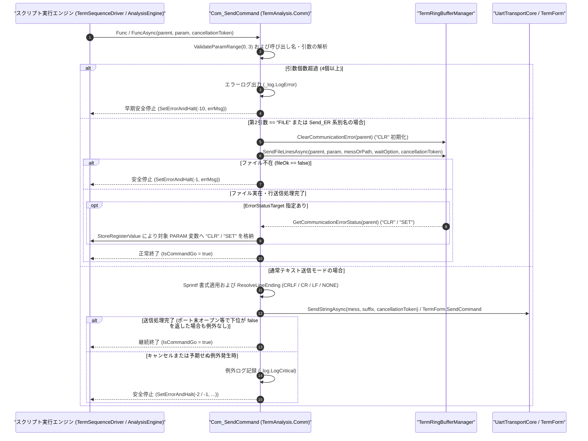

# コマンドリファレンス：Com_Send

## 概要

**Com_Send** は、オープン中の COM ポート（UART）に対してテキスト電文（`Sprintf` 書式整形・改行コード制御対応）または指定ファイルの内容を送信するコマンドです。
第 2 引数に `"FILE"` を指定した場合、またはエラー確認付き別名（`Send_ER` / `Term_Send_ER` / `Analysis_Term_Send_ER`）で呼び出した場合は、ファイル送信を実行した上で通信エラー状態（`"CLR"`: 正常 / `"SET"`: エラー発生）を指定変数へ格納します。

> 💡 **補足** : 通常送信で改行指定を省略した場合、`Tr` 系別名（`Tr` / `Term_Tr` / `Analysis_Term_Tr`）では改行なしでそのまま送信され、それ以外では `Com_Mode` または UI プロパティ画面で設定された送信デリミタ（`TXCR` / `TXCRLF` / `NON`）が自動適用されます。

---

## 💡 書式・パラメータ仕様

### コマンド構文

```csv
; 1. 通常テキスト送信モード（0〜3 引数）
,SEQUENCE, [ステップキー], Com_Send, "[Message]", "[SprintfFormatOrLineEnding]", "[LineEnding]"

; 2. ファイル送信・通信エラー確認モード（第 2 引数 "FILE" または Send_ER 系別名）
,SEQUENCE, [ステップキー], Com_Send, "<FilePath>", "FILE", "[ErrorStatusTarget]"
,SEQUENCE, [ステップキー], Send_ER, "<FilePath>", "[ErrorStatusTargetOrNP]", "[ErrorStatusTarget]"
```

### パラメータ（引数）一覧

| 引数位置 | パラメータ名 | 必須/任意 | 型・制約 | 説明 |
| :---: | :--- | :---: | :--- | :--- |
| 第1引数 | `Message` / `FilePath` | 任意（ファイル送信時は必須） | 文字列 | 送信するテキスト文字列（省略時は空文字＋改行のみ送信）、またはファイル送信モード時の対象テキストファイルパスを指定します。 |
| 第2引数 | `Format` / `Mode` | 任意 | 書式文字列 / 改行コード / `"FILE"` | ・`"FILE"` 指定時：第 1 引数をファイルパスとして読み込み行単位で送信します。<br>・通常送信時：`Sprintf` 書式文字列（例: `"VOLT %.2f"`）を指定して第 1 引数を整形します。なお第 3 引数省略時に `"CRLF"` / `"CR"` / `"LF"` / `"NONE"`（`"NON"`）を指定した場合は改行指定として解釈されます。 |
| 第3引数 | `LineEnding` / `ErrorStatusTarget` | 任意 | 改行指定 / 格納先 PARAM キー | ・通常送信時：末尾改行コード（`"CRLF"` / `"TXCRLF"`, `"CR"` / `"TXCR"`, `"LF"`, `"NONE"` / `"NON"`）を個別指定します。<br>・`"FILE"` または `Send_ER` 系呼び出し時：通信エラー監視結果（`"CLR"`: 正常 / `"SET"`: エラー発生）を書き戻す変数キー名（`$` なし）を指定します（`Send_ER` 系で第 3 引数省略時は、`"NP"` 以外の第 2 引数が格納先キーとなります）。 |

---

## 🔄 特殊置換規約・分岐規約の適用

本コマンドの引数における特殊記法および解釈ルールです。
* **動的置換（`$`）** : 引数内で `$PARAMキー$` のように記述すると、実行時に変数プール（PARAM）の値へ動的置換されます。（適用可能な引数: 入力値となる引数。ただしエラー結果格納先キーには `$` を付けず変数名そのものを指定します）
* **ジャンプ先指定（`#`）** : 本コマンドはジャンプ制御を行わないため適用されません。（適用可能な引数: 非適用）
* **共通コマンド指定（`@`）** : 本コマンドは外部マクロを呼び出さないため、共通コマンド呼び出し記法は適用されません。（適用可能な引数: 非適用）
* **カンマのエスケープ** : 通信条件文字列（例: `"9600,E,7,1"`）や複数データのカンマ区切り値を単一引数として渡す場合は、必ず `"..."` と二重引用符で囲んで記述します。
* **エイリアス（別名）** : `Send`, `Term_Send`, `Analysis_Term_Send`, `Send_ER`, `Term_Send_ER`, `Analysis_Term_Send_ER`, `Tr`, `Term_Tr`, `Analysis_Term_Tr`

---

## 💡 動作例（正しい構文での記述例）

### スクリプト記述例

※COMMAND ブロック配下の子要素行（PARAM, SEQUENCE）は必ず行頭カンマから開始し、スペースインデントや行末コメント（`;`）は記述しないでください。

```csv
COMMAND, "SAMPLE_COM_SEND", ""
,PARAM, "TARGET_VOLT", Text, "設定電圧", "12.5"
,PARAM, "SEND_ERR", Work, "通信エラー状態", ""
,SEQUENCE, 005, Com_Open
; 1. 変数展開を含むASCIIコマンド送信（Com_Mode / UI設定の改行コードを自動付与）
,SEQUENCE, 010, Com_Send, "VOLT $TARGET_VOLT$"
; 2. カンマを含む文字列を改行コード CRLF 明示指定で送信
,SEQUENCE, 020, Com_Send, "CONF:VOLT:DC 10,0.001", "", "CRLF"
; 3. ファイル送信と通信エラー状態（"CLR" / "SET"）の取得・判定
,SEQUENCE, 030, Com_Send, ".\config\init_cmd.txt", "FILE", "SEND_ERR"
,SEQUENCE, 040, Judge, EQU, "$SEND_ERR$", "CLR", #COMM_ERROR_HANDLER#
,SEQUENCE, 050, Com_Close
,SEQUENCE, 060, Exit
; 通信エラー検出時のハンドラ
,SEQUENCE, #COMM_ERROR_HANDLER#, Msg_Box, "ファイル送信中に通信エラー（$SEND_ERR$）を検出しました"
,SEQUENCE, 070, Com_Close
,SEQUENCE, 080, Exit
```

### 実行時の挙動・変数変化

* **実行前の状態** : Term 通信エンジンが初期化され、必要な通信パラメータおよび変数プール（`PARAM`）が準備されている状態。
* **実行後の状態** : 1 回目の `Com_Send` では `"VOLT 12.5"` に既定の送信デリミタが付与されて UART 送信されます。 2 回目の `Com_Send` では `"CONF:VOLT:DC 10,0.001\r\n"` が送信されます。 3 回目の `Com_Send`（`"FILE"` モード）では `.\config\init_cmd.txt` の各行が送信され、通信エラーが発生していなければ変数 `SEND_ERR` に `"CLR"`（エラー発生時は `"SET"`）が格納されます。

---

## 🔄 動作フロー（シーケンス図）



---

## 🚫 エラーハンドリング・安全設計（仕様制限）

1. **引数超過・ファイル不在・キャンセル時の安全停止と通常送信時の未オープン継続仕様** :
   - 4 個以上の引数が指定された場合は `ValidateParamRange(0, 3)` によりエラーコード `-10` で早期停止し、`FILE` モード（または `Send_ER` 系）で対象ファイルが存在しない場合は `SetErrorAndHalt(-1, ...)` により安全に停止します（キャンセル時は `-2`、予期せぬ例外発生時は `-1` で停止）。一方、通常文字列送信モードにおいてポート未オープン等で下位送信（`UartTransportCore.Shared.SendStringAsync` 等）が `false` を返した場合は、エラー停止せず `IsCommandGo = true` のまま次ステップへ継続します（後続の `Com_WaitPrompt` 等でタイムアウト検知可能です）。
2. **通信エラーフラグの自動初期化と状態格納** :
   - `"FILE"` モードまたは `Send_ER` 系呼び出しでは、送信開始前に通信エラーフラグを `"CLR"` にリセットした上で送信を行い、UART 受信エラーイベント等が発生した場合は `"SET"` を変数へ記録します（16 進バイナリ変換 `"HEX"` モードは本コマンドには存在しないため、バイナリ透過制御には `Com_Mode` の `BIN` 設定等を使用してください）。

---

## 🧪 ユニットテスト仕様

本コマンドクラス（`Com_SendCommand.cs`）に実装されている `RunUnitTest()` メソッドが検証するユニットテストの仕様です。

### テスト実行前提条件

* **実行トリガー** : `RunUnitTest()` メソッドの呼び出し
* **有効化条件** : システム全体の最小ログレベル（`ErrorLogger.MinimumLevel`）が `LogLevel.Test` であること（それ以外の場合は無効化ガードにより早期リターン）
* **検証結果出力** : `_log.LogTest` によるログ出力。検証失敗時は `_log.LogError`、予期せぬ例外発生時は `_log.LogCritical` で記録し、`finally` ブロックで `UartTransportCore.Shared.Close()` および `UartTransportCore.Shared.IsSimulationMode` の復元を実行します。

### テストケース一覧

| No | テストカテゴリ | テスト条件（入力値） | 期待される結果（出力値） | 検証の目的 / 観点 |
| :---: | :--- | :--- | :--- | :--- |
| **1** | 正常系 | `IsSimulationMode = true` で `UartTransportCore.Shared.Open()` 後、引数 `"AT+VER?"`, `""`, `"CRLF"` を指定して `Func(null, param)` を実行 | `!param.HasError` かつ送信データ `param.SndData` が `"AT+VER?\r\n"` と一致する | 文字列電文への終端改行コード（`CRLF`）付与および UART 送信処理の検証 |
| **2** | 異常系 | 過剰引数 4 個（`"AT"`, `""`, `"CRLF"`, `"EXTRA_INVALID"`）を指定して `Func(null, invalidParam)` を実行 | `invalidParam.HasError == true` かつ `!invalidParam.IsCommandGo` となり安全に拒否・停止する | 引数上限（`ValidateParamRange(0, 3)`）違反時の境界防御検証 |
