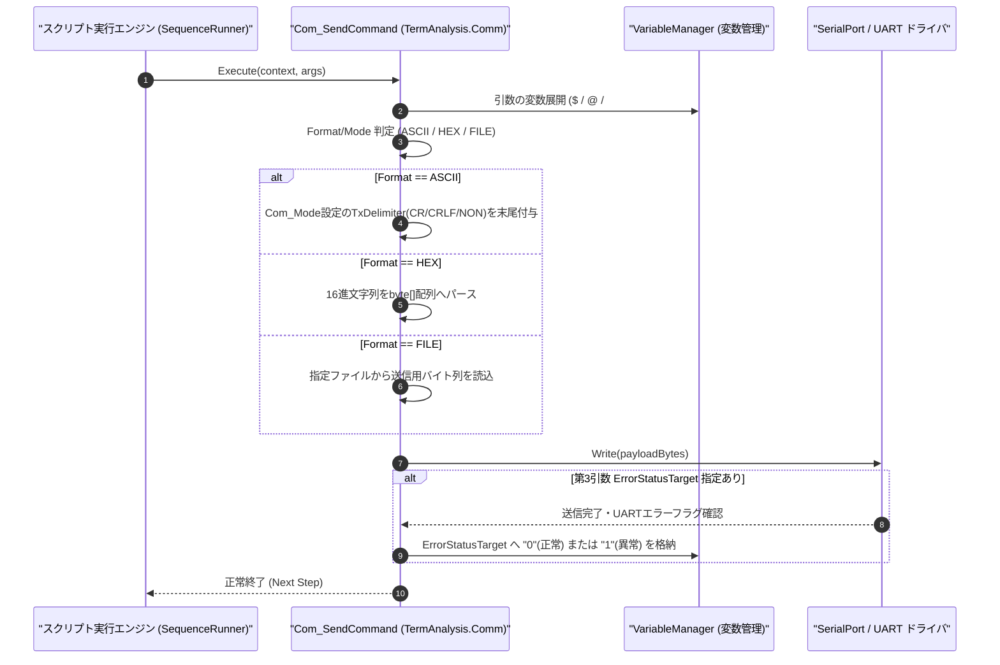

# コマンドリファレンス：Com_Send

---

## 概要

**Com_Send** は、オープン中の COM ポート（UART）に対して文字列メッセージ、16 進バイト列（HEX）、または指定ファイルの内容を送信するコマンドです。
第 3 引数にステータス格納先変数を指定することで、通信エラーフラグ（パリティエラー・フレーミングエラー・タイムアウト等）の監視を伴うエラー確認付き送信（旧 `Term_Send_ER` 相当）としても動作します。

> 💡 **補足**: `Com_Mode` で設定された送信デリミタ（`TXCR` / `TXCRLF` / `NON`）が送信データ末尾に自動付与されます。

---

## 💡 書式・パラメータ仕様

### コマンド構文

```csv
,SEQUENCE,Com_Send, "<Message/FilePath>", "[Format/Mode]", "[ErrorStatusTarget]"
```

### パラメータ（引数）一覧

| 引数位置 | パラメータ名 | 必須/任意 | 型・制約 | 説明 |
| :---: | :--- | :---: | :--- | :--- |
| 第1引数 | `Message/FilePath` | **必須** | 文字列 | 送信する文字列データ、16進文字列、または送信対象ファイルのパスを指定します。 |
| 第2引数 | `Format/Mode` | 任意 | `ASCII` / `HEX` / `FILE`（既定値: `ASCII`） | 送信データの解釈モードを指定します。<br>・`ASCII`: テキスト文字列として送信（デリミタ自動付与）<br>・`HEX`: 16進文字列（例: `"02 41 42 03"`）をバイナリ変換して送信<br>・`FILE`: 第1引数をファイルパスとして読み込み送信 |
| 第3引数 | `ErrorStatusTarget` | 任意 | 変数名（`$` / `@`） | 送信時の通信エラー判定結果（`"0"`: 正常 / `"1"`: エラー発生）を格納する変数名を指定します。 |

---

## 🔄 特殊置換規約・分岐規約の適用

1. **変数展開（`$` / `@` / `#`）の完全サポート**:
   - 第 1 引数に `"CMD_$TARGET_CH"` や `"@SEND_PAYLOAD"` を指定すると、実行時に変数値へ展開されてから送信されます。
2. **カンマを含む文字列の送信**:
   - カンマを含むコマンド文字列（例: `"SET,1,100"`）を送信する場合は、ダブルクォーテーションで囲むことで単一の第 1 引数として保護されます。
3. **レガシー別名互換**:
   - 旧表記の `Term_Send` および `Term_Send_ER` は、内部正規化テーブルにより本 `Com_Send` コマンドへ透過的にマッピングされます。

---

## 💡 動作例（正しい構文での記述例）

### スクリプト記述例

```csv
,PARAM,TARGET_VOLT,12.5
,PARAM,SEND_ERR,0

; 1. 変数展開を含むASCIIコマンド送信
,SEQUENCE,Com_Send, "VOLT $TARGET_VOLT"

; 2. カンマを含む文字列の送信
,SEQUENCE,Com_Send, "CONF:VOLT:DC 10,0.001"

; 3. HEXバイナリフレーム送信とエラーフラグ取得
,SEQUENCE,Com_Send, "02 30 31 03", "HEX", "$SEND_ERR"
,SEQUENCE,Judge, "$SEND_ERR", "==", "1", "COMM_ERROR_HANDLER"
,SEQUENCE,Exit
```

### 実行時の挙動・変数変化

1. 1 回目の `Com_Send` では `"VOLT 12.5"` に送信デリミタ（例: `\r\n`）が付与されて UART 送信されます。
2. 2 回目の `Com_Send` では `"CONF:VOLT:DC 10,0.001"` がそのまま送信されます。
3. 3 回目の `Com_Send` では 4 バイトのバイナリ `[0x02, 0x30, 0x31, 0x03]` が送信され、通信エラーがなければ `$SEND_ERR` に `"0"` が格納されます。

---

## 🔄 動作フロー（シーケンス図）



---

## 🚫 エラーハンドリング・安全設計（仕様制限）

1. **ポート未オープン時の実行防止**:
   - `Com_Open` が実行されていない状態で `Com_Send` を呼び出した場合、未接続エラーを送出してシーケンスを停止します。
2. **不正な HEX 文字列の検証**:
   - `HEX` モード指定時に 16 進数として解釈できない文字（`"GG"` 等）や奇数桁が含まれる場合は、`FormatException` を送出して不正フレーム送信を防止します。

---

## 🧪 ユニットテスト仕様

### テスト実行前提条件
- **対象クラス**: `TermAnalysis.Comm.Com_SendCommand`（`Com_SendCommand.cs`）
- **モック環境**: オープン状態の `ISerialPortAdapter` モックが注入されていること。

### テストケース一覧

| テストID | テスト観点 | 入力スクリプト | 期待される動作・検証項目 |
| :--- | :--- | :--- | :--- |
| `UT-COM-SEND-01` | ASCII送信・変数展開 | `,SEQUENCE,Com_Send, "IDN? $CH"` | 変数展開後の文字列に現在の `TxDelimiter` が付与されて送信されること。 |
| `UT-COM-SEND-02` | HEXバイナリ送信 | `,SEQUENCE,Com_Send, "02 41 03", "HEX"` | バイト配列 `{0x02, 0x41, 0x03}` がデリミタなしで直接送信されること。 |
| `UT-COM-SEND-03` | エラーステータス格納 | `,SEQUENCE,Com_Send, "PING", "ASCII", "$ERR"` | 正常送信時に `$ERR` に `"0"`、UART エラー発生時に `"1"` が格納されること。 |

