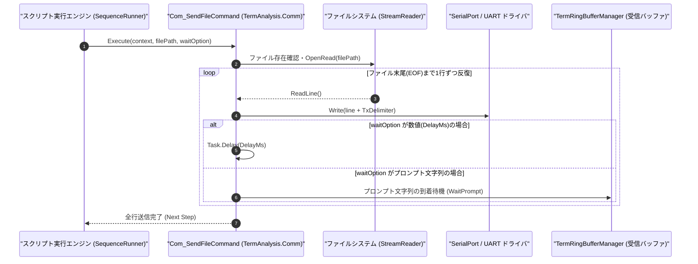

# コマンドリファレンス：Com_SendFile

## 概要

**Com_SendFile** は、指定されたテキストファイルの内容を 1 行ずつ読み込み、オープン中の COM ポート（UART）へ逐次送信するコマンドです。
第 2 引数に行間ウェイト時間（ミリ秒）またはプロンプト文字列を指定することで、相手機器の受信バッファ溢れを防ぎながら確実にバッチ設定ファイルを流し込むことができます。

> 💡 **補足**: 大量の初期設定コマンドリストやファームウェア設定スクリプトを外部ファイルから一括送信する用途に適しています。

---

## 💡 書式・パラメータ仕様

### コマンド構文

```csv
,SEQUENCE, [ステップキー], Com_SendFile, [FilePath], "[WaitPromptMode: WaitPrompt]", "[ClearError: false]"
```

### パラメータ（引数）一覧

| 引数位置 | 引数名 | 必須/任意 | 説明・制約 |
| :--- | :--- | :---: | :--- |
| 第 1 引数 | `FilePath` | **必須** | 送信するテキストファイルのパス（相対パスまたは絶対パス）。 |
| 第 2 引数 | `WaitPromptMode` | 任意 | 行間待機モード、ミリ秒ディレイ数値、またはプロンプト文字列（省略時既定値: `"WaitPrompt"`、`"NoWait"` または `"50"` 等も指定可）。 |
| 第 3 引数 | `ClearError` | 任意 | 送信開始前に既存の通信エラー状態をクリアするかを示す真偽値（`"true"` / `"false"`、省略時既定値: `false`）。 |

---

## 🔄 特殊置換規約・分岐規約の適用

本コマンドの引数における特殊記法および解釈ルールです。
* **動的置換（`$`）**: 引数内で `$PARAMキー$` のように記述すると、実行時に変数プール（PARAM）の値へ動的置換されます。（適用可能な引数: 全引数対応）
* **ジャンプ先指定（`#`）**: 本コマンドはジャンプ制御を行わないため適用されません。（適用可能な引数: 非適用）
* **共通コマンド指定（`@`）**: 本コマンドは外部マクロを呼び出さないため、共通コマンド呼び出し記法は適用されません。（適用可能な引数: 非適用）
* **カンマのエスケープ**: 通信条件文字列（例: `"9600,E,7,1"`）や複数データのカンマ区切り値を単一引数として渡す場合は、必ず `"..."` と二重引用符で囲んで記述します。
* **エイリアス（別名）**: `SendFile`, `Term_SendFile`, `Analysis_Term_SendFile`, `SendFile_NP`, `Term_SendFile_NP`, `Send_ER`

---

## 💡 動作例（正しい構文での記述例）

### スクリプト記述例

※COMMAND ブロック配下の子要素行（PARAM, SEQUENCE）は必ず行頭カンマから開始し、スペースインデントや行末コメント（`;`）は記述しないでください。

```csv
COMMAND, "SAMPLE_COM_SENDFILE", ""
,PARAM, "BATCH_FILE", Text, "BATCH_FILE", ".\config\router_init.txt"
; 1. 1行ごとに100msの間隔を空けて設定ファイルを逐次送信
,SEQUENCE, 010, Com_Open
,SEQUENCE, 020, Com_SendFile, "$BATCH_FILE$", "100"
; 2. 1行ごとに機器からの「#」プロンプト応答を待ちながら逐次送信
,SEQUENCE, 030, Com_SendFile, ".\config\calib_table.txt", "#"
,SEQUENCE, 040, Com_Close
,SEQUENCE, 050, Exit
```

### 実行時の挙動・変数変化

* **実行前の状態**: Term 通信エンジンが初期化され、必要な通信パラメータおよび変数プール（`PARAM`）が準備されている状態。
* **実行後の状態**: 1 回目の `Com_SendFile` では、`.\config\router_init.txt` の各行が 100ms のインターバルを挟みながら順番に UART 送信されます。 2 回目の `Com_SendFile` では、1 行送信するたびに受信リングバッファ（`TermRingBufferManager`）に `"#"` が現れるのを待ってから次の行を送信します。

---

## 🔄 動作フロー（シーケンス図）



---

## 🚫 エラーハンドリング・安全設計（仕様制限）

1. **ファイル不在時の事前チェック**:
   - 指定されたファイルが存在しない場合は、1 バイトも送信せずに `FileNotFoundException` を送出してシーケンスを停止します。
2. **プロンプト待機タイムアウト防止**:
   - 第 2 引数にプロンプト文字列を指定した際、規定時間（既定 10,000ms）以内に応答がない場合はタイムアウト例外を送出し、無限ハングアップを防止します。

---

## 🧪 ユニットテスト仕様

本コマンドクラス（`Com_SendFileCommand.cs`）に実装されている `RunUnitTest()` メソッドが検証するユニットテストの仕様です。

### テスト実行前提条件

* **実行トリガー**: `RunUnitTest()` メソッドの呼び出し
* **有効化条件**: システム全体の最小ログレベル（`ErrorLogger.MinimumLevel`）が `LogLevel.Test` であること（それ以外の場合は無効化ガードにより早期リターン）
* **検証結果出力**: `_log.LogTest` によるログ出力。検証失敗時は `_log.LogError`、予期せぬ例外発生時は `_log.LogCritical` で記録し、`finally` ブロックでテスト用一時ファイル（`tempFile`）の削除、`UartTransportCore.Shared.Close()`、および `IsSimulationMode` の復元を実行します。

### テストケース一覧

| No | テストカテゴリ | テスト条件（入力値） | 期待される結果（出力値） | 検証の目的 / 観点 |
| :---: | :--- | :--- | :--- | :--- |
| **1** | 正常系 | 一時ファイル `Com_SendFile_Test_<GUID>.txt`（内容 `"CMD1\r\nCMD2\r\n"`）を生成し、`IsSimulationMode = true` 環境下で引数 `tempFile`, `"NoWait"`, `"true"` を指定して実行 | `!param.HasError` かつ `param.IsCommandGo == true` で全行送信が正常完了する | エラークリア指定およびプロンプト待機なし（`NoWait`）でのテキストファイル逐次送信の検証 |
| **2** | 異常系 | 必須引数 `FilePath` 欠落・引数範囲外（`ValidateParamRange(1, 3)` 違反）、または存在しないファイルパスの指定 | `_log.LogError` 出力および `SetErrorAndHalt(-1, errMsg)` により未送信のまま安全に停止する | 必須ファイルパス検証およびファイル不在時のクラッシュ防御検証 |
