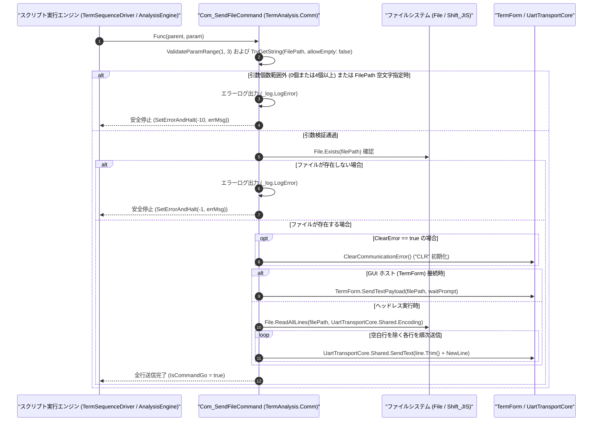

# コマンドリファレンス：Com_SendFile

## 概要

**Com_SendFile** は、指定されたテキストファイル（既定文字コード：Shift_JIS / CP932）の内容を読み込み、オープン中の COM ポート（UART）へ一括・逐次送信するコマンドです。
第 2 引数または別名（`*_NP`）により GUI 実行時の送信進捗・キャンセルダイアログの表示有無を制御でき、第 3 引数により送信開始前の通信エラー状態クリア（`"CLR"` 初期化）を指定できます。

> 💡 **補足** : 大量の初期設定コマンドリストやバッチ設定ファイルを外部ファイルから流し込む用途に適しています。なお、`Com_SendFile` は行間ミリ秒ディレイやプロンプト文字列の到着待機は行わないため、1 コマンドごとに応答確認が必要な場合は `Com_Send` と `Com_WaitPrompt`（または `Wait`）を組み合わせて使用してください。

---

## 💡 書式・パラメータ仕様

### コマンド構文

```csv
,SEQUENCE, [ステップキー], Com_SendFile, [FilePath], "[WaitPromptMode: WaitPrompt]", "[ClearError: false]"
```

### パラメータ（引数）一覧

| 引数位置 | 引数名 | 必須/任意 | 説明・制約 |
| :--- | :--- | :---: | :--- |
| 第 1 引数 | `FilePath` | **必須** | 送信するテキストファイルのパス（相対パスまたは絶対パス。読込エンコーディングは `UartTransportCore.Shared.Encoding`［既定 Shift_JIS / CP932］を使用。ヘッドレス実行時は空白行をスキップし、各行の前後空白を除去 `Trim()` した上で終端改行を付加して送信します）。 |
| 第 2 引数 | `WaitPromptMode` | 任意 | GUI ホスト接続時の送信ダイアログ表示モード（省略時既定値: `"WaitPrompt"`＝進捗・キャンセルダイアログ表示。`"NoWait"` / `"NP"` / `"false"` / `"0"` 指定時、または `*_NP` 別名呼び出し時はダイアログ非表示で送信）。※行間ミリ秒待機やプロンプト文字列待機は行いません。 |
| 第 3 引数 | `ClearError` | 任意 | 送信開始前に既存の通信エラー状態を `"CLR"` にクリアするかを示す真偽値（`"true"` / `"1"` でクリア実行、省略時既定値: `false`）。 |

---

## 🔄 特殊置換規約・分岐規約の適用

本コマンドの引数における特殊記法および解釈ルールです。
* **動的置換（`$`）** : 引数内で `$PARAMキー$` のように記述すると、実行時に変数プール（PARAM）の値へ動的置換されます。（適用可能な引数: 全引数対応）
* **ジャンプ先指定（`#`）** : 本コマンドはジャンプ制御を行わないため適用されません。（適用可能な引数: 非適用）
* **共通コマンド指定（`@`）** : 本コマンドは外部マクロを呼び出さないため、共通コマンド呼び出し記法は適用されません。（適用可能な引数: 非適用）
* **カンマのエスケープ** : 通信条件文字列（例: `"9600,E,7,1"`）や複数データのカンマ区切り値を単一引数として渡す場合は、必ず `"..."` と二重引用符で囲んで記述します。
* **エイリアス（別名）** : `SendFile`, `Term_SendFile`, `Analysis_Term_SendFile`, `SendFile_NP`, `Term_SendFile_NP`, `Analysis_Term_SendFile_NP`

---

## 💡 動作例（正しい構文での記述例）

### スクリプト記述例

※COMMAND ブロック配下の子要素行（PARAM, SEQUENCE）は必ず行頭カンマから開始し、スペースインデントや行末コメント（`;`）は記述しないでください。

```csv
COMMAND, "SAMPLE_COM_SENDFILE", ""
,PARAM, "BATCH_FILE", Text, "設定ファイルパス", ".\config\router_init.txt"
; 1. 進捗ダイアログ表示あり（既定）で初期設定ファイルを一括送信
,SEQUENCE, 010, Com_Open
,SEQUENCE, 020, Com_SendFile, "$BATCH_FILE$", "WaitPrompt", "true"
; 2. ダイアログ非表示（NoWait）でテーブル設定ファイルを連続送信し、完了応答を待機
,SEQUENCE, 030, Com_SendFile, ".\config\calib_table.txt", "NoWait"
,SEQUENCE, 040, Com_WaitPrompt, "COMPLETE", "5000"
,SEQUENCE, 050, Com_Close
,SEQUENCE, 060, Exit
```

### 実行時の挙動・変数変化

* **実行前の状態** : Term 通信エンジンが初期化され、必要な通信パラメータおよび変数プール（`PARAM`）が準備されている状態。
* **実行後の状態** : 1 回目の `Com_SendFile` では、既存の通信エラー状態が `"CLR"` にクリアされた後、`.\config\router_init.txt` の内容が Shift_JIS（CP932）で読み込まれ、GUI 接続時は送信ダイアログ経由で分割送信（ヘッドレス時は空白行を除いた各 `Trim()` 行へ `NewLine` を付加して `UartTransportCore.Shared.SendText` で逐次送信）されます。 2 回目の `Com_SendFile` ではダイアログを表示せずに `.\config\calib_table.txt` が連続送信され、続く `Com_WaitPrompt` で完了応答 `"COMPLETE"` を確認してからポートをクローズします。

---

## 🔄 動作フロー（シーケンス図）



---

## 🚫 エラーハンドリング・安全設計（仕様制限）

1. **必須引数欠落・空文字エラー（`-10`）およびファイル不在エラー（`-1`）の事前チェックと安全停止** :
   - 引数個数が範囲外（0 個または 4 個以上：`ValidateParamRange(1, 3)` 違反）である場合や、必須の第 1 引数 `FilePath` に空白・空文字が指定された場合（`TryGetString(..., allowEmpty: false)` 違反）は、1 バイトも送信せずにエラーログを出力し、エラーコード **`-10`** （`SetErrorAndHalt(-10, errMsg)`）によりシーケンスを安全に停止します。また、指定されたファイルが存在しない場合はエラーログを出力し、エラーコード **`-1`** （`SetErrorAndHalt(-1, errMsg)`）により安全に停止します。
2. **送信完了後の応答確認との分離設計** :
   - 本コマンドはファイルの送出処理に専念し、行間のプロンプト文字列待ちやミリ秒ディレイは行いません（エラー確認変数の書き戻しを伴うファイル送信が必要な場合は `Com_Send` の `"FILE"` モードまたは `Send_ER` 別名を使用してください）。

---

## 🧪 ユニットテスト仕様

本コマンドクラス（`Com_SendFileCommand.cs`）に実装されている `RunUnitTest()` メソッドが検証するユニットテストの仕様です。

### テスト実行前提条件

* **実行トリガー** : `RunUnitTest()` メソッドの呼び出し
* **有効化条件** : システム全体の最小ログレベル（`ErrorLogger.MinimumLevel`）が `LogLevel.Test` であること（それ以外の場合は無効化ガードにより早期リターン）
* **検証結果出力** : `_log.LogTest` によるログ出力。検証失敗時は `_log.LogError`、予期せぬ例外発生時は `_log.LogCritical` で記録し、`finally` ブロックでテスト用一時ファイル（`tempFile`）の削除、`UartTransportCore.Shared.Close()`、および `IsSimulationMode` の復元を実行します。

### テストケース一覧

| No | テストカテゴリ | テスト条件（入力値） | 期待される結果（出力値） | 検証の目的 / 観点 |
| :---: | :--- | :--- | :--- | :--- |
| **1** | 正常系 | 一時ファイル `Com_SendFile_Test_<GUID>.txt`（内容 `"CMD1\r\nCMD2\r\n"`）を生成し、`IsSimulationMode = true` 環境下で引数 `tempFile`, `"NoWait"`, `"true"` を指定して `Func(null, param)` を実行 | `!param.HasError` かつ `param.IsCommandGo == true` で全行送信が正常完了する | エラークリア指定およびダイアログ非表示（`NoWait`）でのテキストファイル逐次送信の検証 |
| **2** | 異常系 | 必須引数 `FilePath` を省略（引数 0 個）して `Func(null, invalidParam)` を実行 | `invalidParam.HasError == true` かつ `!invalidParam.IsCommandGo` となり未送信のまま安全に拒否・停止する | 必須ファイルパス欠落時（`ValidateParamRange(1, 3)`）の境界防御検証 |
