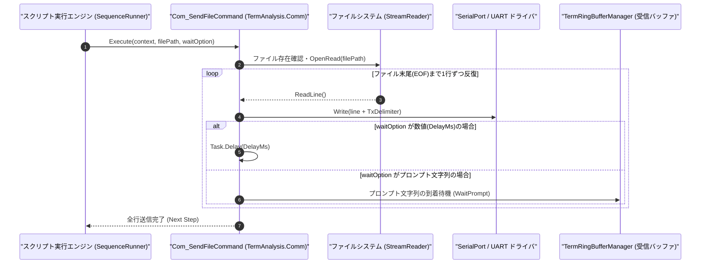

# コマンドリファレンス：Com_SendFile

---

## 概要

**Com_SendFile** は、指定されたテキストファイルの内容を 1 行ずつ読み込み、オープン中の COM ポート（UART）へ逐次送信するコマンドです。
第 2 引数に行間ウェイト時間（ミリ秒）またはプロンプト文字列を指定することで、相手機器の受信バッファ溢れを防ぎながら確実にバッチ設定ファイルを流し込むことができます。

> 💡 **補足**: 大量の初期設定コマンドリストやファームウェア設定スクリプトを外部ファイルから一括送信する用途に適しています。

---

## 💡 書式・パラメータ仕様

### コマンド構文

```csv
,SEQUENCE,Com_SendFile, "<FilePath>", "[WaitPrompt/DelayMs]"
```

### パラメータ（引数）一覧

| 引数位置 | パラメータ名 | 必須/任意 | 型・制約 | 説明 |
| :---: | :--- | :---: | :--- | :--- |
| 第1引数 | `FilePath` | **必須** | 文字列（ファイルパス） | 送信するテキストファイルのパス（相対パスまたは絶対パス）を指定します。 |
| 第2引数 | `WaitPrompt/DelayMs` | 任意 | 数値文字列 または プロンプト文字列（既定値: `"0"`） | ・数値（例: `"50"`）を指定した場合：1行送信ごとに指定ミリ秒待機します。<br>・文字列（例: `">"`）を指定した場合：1行送信ごとにそのプロンプトが受信されるまで待機します。 |

---

## 🔄 特殊置換規約・分岐規約の適用

1. **ファイルパスおよび待機条件の変数展開**:
   - 第 1 引数・第 2 引数ともに `$` / `@` / `#` による変数展開が適用されます（例: `"$CONFIG_DIR\init_cmd.txt"`）。
2. **送信デリミタの自動適用**:
   - ファイルから読み込まれた各行の改行コードはいったん正規化され、`Com_Mode` で設定されている送信デリミタ（`TXCR` / `TXCRLF` / `NON`）が付与されて送信されます。

---

## 💡 動作例（正しい構文での記述例）

### スクリプト記述例

```csv
,PARAM,BATCH_FILE,.\config\router_init.txt

; 1. 1行ごとに100msの間隔を空けて設定ファイルを逐次送信
,SEQUENCE,Com_Open
,SEQUENCE,Com_SendFile, "$BATCH_FILE", "100"

; 2. 1行ごとに機器からの「#」プロンプト応答を待ちながら逐次送信
,SEQUENCE,Com_SendFile, ".\config\calib_table.txt", "#"
,SEQUENCE,Com_Close
,SEQUENCE,Exit
```

### 実行時の挙動・変数変化

1. 1 回目の `Com_SendFile` では、`.\config\router_init.txt` の各行が 100ms のインターバルを挟みながら順番に UART 送信されます。
2. 2 回目の `Com_SendFile` では、1 行送信するたびに受信リングバッファ（`TermRingBufferManager`）に `"#"` が現れるのを待ってから次の行を送信します。

---

## 🔄 動作フロー（シーケンス図）



---

## 🚫 エラーハンドリング・安全設計（仕様制限）

1. **ファイル不在時の事前チェック**:
   - 指定されたファイルが存在しない場合は、1 バイトも送信せずに `FileNotFoundException` を送出してシーケンスを停止します。
2. **プロンプト待機タイムアウト防止**:
   - 第 2 引数にプロンプト文字列を指定した際、規定時間（既定 10,000ms）以内に応答がない場合はタイムアウト例外を送出し、無限ハングアップを防止します。

---

## 🧪 ユニットテスト仕様

### テスト実行前提条件
- **対象クラス**: `TermAnalysis.Comm.Com_SendFileCommand`（`Com_SendFileCommand.cs`）
- **モック環境**: テスト用一時ファイル（3 行のテキスト）および `ISerialPortAdapter` モックが準備されていること。

### テストケース一覧

| テストID | テスト観点 | 入力スクリプト | 期待される動作・検証項目 |
| :--- | :--- | :--- | :--- |
| `UT-COM-SENDFILE-01` | 正常系（行間ディレイ送信） | `,SEQUENCE,Com_SendFile, "test3lines.txt", "10"` | ファイル内の 3 行すべてが順番に送信されること。 |
| `UT-COM-SENDFILE-02` | 正常系（プロンプト同期送信） | `,SEQUENCE,Com_SendFile, "test3lines.txt", "OK>"` | 各行送信後に `"OK>"` の受信を確認してから次行が送信されること。 |
| `UT-COM-SENDFILE-03` | 異常系（ファイル不在） | `,SEQUENCE,Com_SendFile, "not_found.txt"` | `FileNotFoundException` が発生し、エラーログが出力されること。 |

