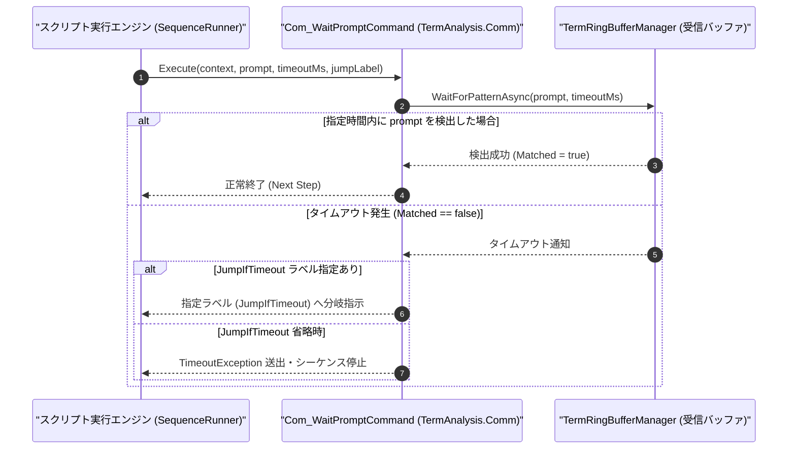

# コマンドリファレンス：Com_WaitPrompt

---

## 概要

**Com_WaitPrompt** は、COM ポート（UART）の非同期受信リングバッファ（`TermRingBufferManager`）を監視し、指定されたプロンプト文字列（または応答キーワード）が受信されるまで待機するコマンドです。
指定したタイムアウト時間内にプロンプトが受信されなかった場合、第 3 引数に指定したラベルへ自動的にジャンプ（分岐）させることができます。

> 💡 **補足**: ポーリングによる CPU 負荷を抑えた非同期イベント駆動で監視を行います。

---

## 💡 書式・パラメータ仕様

### コマンド構文

```csv
,SEQUENCE,Com_WaitPrompt, "<Prompt>", "[TimeoutMs: 10000]", "[JumpIfTimeout]"
```

### パラメータ（引数）一覧

| 引数位置 | パラメータ名 | 必須/任意 | 型・制約 | 説明 |
| :---: | :--- | :---: | :--- | :--- |
| 第1引数 | `Prompt` | **必須** | 文字列 | 受信を待機するプロンプト文字列または応答パターン（例: `"READY>"`, `"OK"`, `"LOGIN:"`）を指定します。 |
| 第2引数 | `TimeoutMs` | 任意 | 整数（ミリ秒、既定値: `10000`） | 最大待機時間をミリ秒単位で指定します。省略時は `10000`（10秒）となります。 |
| 第3引数 | `JumpIfTimeout` | 任意 | ラベル名 / ステップ番号 | タイムアウト発生時にジャンプする遷移先ラベルを指定します。省略時はタイムアウト例外を送出して停止します。 |

---

## 🔄 特殊置換規約・分岐規約の適用

1. **変数展開（`$` / `@` / `#`）**:
   - 第 1 引数のプロンプト文字列や第 2 引数のタイムアウト値には変数を使用できます（例: `"$EXPECTED_PROMPT"`, `"$TIMEOUT_MS"`）。
2. **タイムアウト分岐規約**:
   - 第 3 引数 `JumpIfTimeout` が指定されている場合、タイムアウト発生時に異常終了せず、指定されたラベルステップへプログラムカウンタ（PC）を遷移させます。

---

## 💡 動作例（正しい構文での記述例）

### スクリプト記述例

```csv
,PARAM,RETRY_CNT,0

,SEQUENCE,Com_Open
:SEND_RETRY
,SEQUENCE,Com_Send, "PING"
; 3秒以内に "PONG" が返らなければ TIMEOUT_HANDLE ラベルへ分岐
,SEQUENCE,Com_WaitPrompt, "PONG", "3000", "TIMEOUT_HANDLE"
,SEQUENCE,Msg_Box, "通信成功：PONGを受信しました"
,SEQUENCE,Com_Close
,SEQUENCE,Exit

:TIMEOUT_HANDLE
,SEQUENCE,Param_Add, "$RETRY_CNT", "1", "$RETRY_CNT"
,SEQUENCE,Judge, "$RETRY_CNT", "<", "3", "SEND_RETRY"
,SEQUENCE,Msg_Box, "通信タイムアウト：リトライ上限に達しました"
,SEQUENCE,Com_Close
,SEQUENCE,Exit
```

### 実行時の挙動・変数変化

1. `"PING"` 送信後、`Com_WaitPrompt` は最大 3,000ms の間 `"PONG"` の到着を待機します。
2. 3,000ms 以内に `"PONG"` が受信されれば次の `Msg_Box` へ進みます。
3. タイムアウトした場合は `:TIMEOUT_HANDLE` へジャンプし、`$RETRY_CNT` を加算して最大 3 回まで再試行します。

---

## 🔄 動作フロー（シーケンス図）



---

## 🚫 エラーハンドリング・安全設計（仕様制限）

1. **空プロンプト指定の禁止**:
   - 第 1 引数 `Prompt` が空文字列の場合は、`ArgumentException` を送出して無条件通過による誤動作を防止します。
2. **キャンセル要求への即時応答**:
   - 待機中にユーザーが UI から「停止」ボタンを押した場合、`CancellationToken` により待機ループを即座に中断して安全に終了します。

---

## 🧪 ユニットテスト仕様

### テスト実行前提条件
- **対象クラス**: `TermAnalysis.Comm.Com_WaitPromptCommand`（`Com_WaitPromptCommand.cs`）
- **モック環境**: `TermRingBufferManager` に疑似受信データを非同期投入できるテストハーネスが構成されていること。

### テストケース一覧

| テストID | テスト観点 | 入力スクリプト | 期待される動作・検証項目 |
| :--- | :--- | :--- | :--- |
| `UT-COM-WAIT-01` | 正常系（プロンプト検出） | `,SEQUENCE,Com_WaitPrompt, "READY>", "2000"` | バッファに `"READY>"` が到着した時点で即座に待機完了し次ステップへ進むこと。 |
| `UT-COM-WAIT-02` | 正常系（タイムアウト分岐） | `,SEQUENCE,Com_WaitPrompt, "READY>", "100", "ERR_LBL"` | 100ms 経過後に例外で止まらず、遷移先が `"ERR_LBL"` に設定されること。 |
| `UT-COM-WAIT-03` | 異常系（タイムアウト停止） | `,SEQUENCE,Com_WaitPrompt, "READY>", "100"` | 第 3 引数省略時に 100ms 経過すると `TimeoutException` が送出されること。 |

