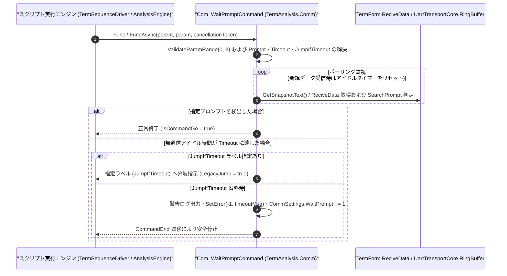

# コマンドリファレンス：Com_WaitPrompt

## 概要

**Com_WaitPrompt** は、COM ポート（UART）の非同期受信リングバッファ（`TermRingBufferManager`）を監視し、指定されたプロンプト文字列（または応答キーワード）が受信されるまで待機するコマンドです。
指定したタイムアウト時間内にプロンプトが受信されなかった場合、第 3 引数に指定したラベルへ自動的にジャンプ（分岐）させることができます。

> 💡 **補足** : ポーリングによる CPU 負荷を抑えた非同期イベント駆動で監視を行います。

---

## 💡 書式・パラメータ仕様

### コマンド構文

```csv
; 1. 標準統一構文（Com_WaitPrompt）
,SEQUENCE, [ステップキー], Com_WaitPrompt, "[Prompt]", "[TimeoutMsOrSec]", "[JumpIfTimeout]"

; 2. WaitChar 系別名構文（WaitChar / Term_WaitChar / Analysis_Term_WaitChar：第2・第3引数が逆順）
,SEQUENCE, [ステップキー], WaitChar, "[Prompt]", "[JumpIfTimeout]", "[TimeoutSec]"
```

※ 第 1 引数に既存のステップキー（ジャンプ先）を指定した場合（または旧別名 `WaitPrompt` / `Term_WaitPrompt` で第 1 引数が空・整数・既存ステップキーの場合）は、旧互換形式 `Com_WaitPrompt, #JumpIfTimeout#, "[TimeoutSec]", "[Prompt]"` として解釈されます。また、 **`WaitChar` / `Term_WaitChar` / `Analysis_Term_WaitChar` 別名で呼び出した場合は、第 1 引数＝`Prompt`（部分一致検索文字列）、第 2 引数＝`JumpIfTimeout`（タイムアウト時ジャンプ先）、第 3 引数＝`TimeoutSec`（タイムアウト秒数または `100` 以上 ms）の引数順序** になります。

### パラメータ（引数）一覧（標準 `Com_WaitPrompt` 構文）

| 引数位置 | パラメータ名 | 必須/任意 | 型・制約 | 説明 |
| :---: | :--- | :---: | :--- | :--- |
| 第1引数 | `Prompt` | 任意 | 文字列 | 受信を待機するプロンプト文字列または登録プロンプトキー（例: `"READY>"`, `"OK"`, `"LOGIN:"`）を指定します。省略または空文字の場合は、コマンドに登録済みの `Prompts` 定義一覧に一致する文字列を待機します（送信エコー行の誤検知を防ぐため、先頭 1 行目をスキップした 2 行目以降を逆順検索し、未検出時に全体検索します。`WaitChar` 系別名時は第 1 引数文字列の単純部分一致検索を行います）。 |
| 第2引数 | `TimeoutMsOrSec`<br>（※`WaitChar` 系では第 3 引数） | 任意 | 数値（ミリ秒または秒） | 無通信アイドル待機時間を指定します。 **`100` 以上の値はミリ秒単位（ms）、`100` 未満の正数は秒単位（`× 1000` ms、最小 `50` ms）** として自動換算されます（例: `"5"` ➔ `5000` ms、`"3000"` ➔ `3000` ms）。省略時は UI の `Comm` タブ設定 `WaitPrompt` 秒数（UI 既定値 `3` 秒 ＝ `3000` ms、UI 未接続時は `10000` ms）が適用されます。新規データを受信するたびにタイマーはリセットされます。 |
| 第3引数 | `JumpIfTimeout`<br>（※`WaitChar` 系では第 2 引数） | 任意 | `#ラベル名#` / ステップキー | タイムアウト発生時にジャンプする遷移先ラベルを指定します。省略時は警告ログおよび `SetError(-1, ...)` を記録し、GUI の通信設定タブ（`CommSettings`）が存在する場合はプロンプト待ち時間 `WaitPrompt` を `+1` 秒自動加算（`Setting.xml` 更新）した上で、`CommandEnd` へ遷移してシーケンスを安全に停止します。 |

---

## 🔄 特殊置換規約・分岐規約の適用

本コマンドの引数における特殊記法および解釈ルールです。
* **動的置換（`$`）** : 引数内で `$PARAMキー$` のように記述すると、実行時に変数プール（PARAM）の値へ動的置換されます。（適用可能な引数: 全引数対応）
* **ジャンプ先指定（`#`）** : タイムアウト発生時の遷移先ラベルを `#ラベル名#` の形式で指定できます。（適用可能な引数: `JumpIfTimeout` 引数）
* **共通コマンド指定（`@`）** : 本コマンドは外部マクロを呼び出さないため、共通コマンド呼び出し記法は適用されません。（適用可能な引数: 非適用）
* **カンマのエスケープ** : 通信条件文字列（例: `"9600,E,7,1"`）や複数データのカンマ区切り値を単一引数として渡す場合は、必ず `"..."` と二重引用符で囲んで記述します。
* **エイリアス（別名）** : `WaitPrompt`, `Term_WaitPrompt`, `Analysis_Term_WaitPrompt`, `WaitChar`, `Term_WaitChar`, `Analysis_Term_WaitChar`

---

## 💡 動作例（正しい構文での記述例）

### スクリプト記述例

※COMMAND ブロック配下の子要素行（PARAM, SEQUENCE）は必ず行頭カンマから開始し、スペースインデントや行末コメント（`;`）は記述しないでください。

```csv
COMMAND, "SAMPLE_COM_WAITPROMPT", ""
,PARAM, "RETRY_CNT", Work, "リトライ回数", "0"
,SEQUENCE, 010, Com_Open
,SEQUENCE, #SEND_RETRY#, Com_Send, "PING"
; 3000ms（"3" でも同義）以内に "PONG" が返らなければ #TIMEOUT_HANDLE# ラベルへ分岐
,SEQUENCE, 020, Com_WaitPrompt, "PONG", "3000", #TIMEOUT_HANDLE#
,SEQUENCE, 030, Msg_Box, "通信成功：PONGを受信しました"
,SEQUENCE, 040, Com_Close
,SEQUENCE, 050, Exit
; タイムアウト時のリトライ制御（3回未満なら #SEND_RETRY# へ戻る）
,SEQUENCE, #TIMEOUT_HANDLE#, ParamInc, "RETRY_CNT", "1"
,SEQUENCE, 060, Judge, GE, "$RETRY_CNT$", "3", #SEND_RETRY#
,SEQUENCE, 070, Msg_Box, "通信タイムアウト：リトライ上限（3回）に達しました"
,SEQUENCE, 080, Com_Close
,SEQUENCE, 090, Exit
```

### 実行時の挙動・変数変化

* **実行前の状態** : Term 通信エンジンが初期化され、必要な通信パラメータおよび変数プール（`PARAM`）が準備されている状態。
* **実行後の状態** : `"PING"` 送信後、`Com_WaitPrompt` は無通信アイドル時間が 3,000ms に達するまで `"PONG"` の到着を待機します。時間内に `"PONG"` が受信されれば次の `Msg_Box` へ進みます。タイムアウトした場合は `#TIMEOUT_HANDLE#` へジャンプし、`ParamInc` で `RETRY_CNT` を 1 加算した上で、`Judge`（`GE`: 3 以上でなければ `#SEND_RETRY#` へ分岐）により最大 3 回まで再送します。

---

## 🔄 動作フロー（シーケンス図）



---

## 🚫 エラーハンドリング・安全設計（仕様制限）

1. **登録プロンプト連携とエコーバック誤検知防止** :
   - 第 1 引数 `Prompt` 省略時は例外とせずコマンド定義内の登録プロンプト群を検索します。通常モード（`WaitPrompt` 系）では送信コマンドのエコーバック行による即時誤一致を防ぐため、先頭 1 行目を除外した 2 行目以降から優先検索を行います。
2. **アイドルタイムアウト方式・待機時間の自動加算補正・キャンセル即時応答** :
   - 大量ログ出力中に途中切断されないよう、新規データを受信している間はタイマーを自動延長（リセット）します。`JumpIfTimeout` を省略した状態でタイムアウトが発生した場合は `SetError(-1, ...)` で安全停止するとともに、GUI 接続時は通信ポート設定の `WaitPrompt` 秒数を `+1` 秒自動加算して設定へ反映します。また待機中にユーザーが停止操作を行った場合は `CancellationToken` により即座に待機ループを中断しエラーコード `-2` で安全に停止します。

---

## 🧪 ユニットテスト仕様

本コマンドクラス（`Com_WaitPromptCommand.cs`）に実装されている `RunUnitTest()` メソッドが検証するユニットテストの仕様です。

### テスト実行前提条件

* **実行トリガー** : `RunUnitTest()` メソッドの呼び出し
* **有効化条件** : システム全体の最小ログレベル（`ErrorLogger.MinimumLevel`）が `LogLevel.Test` であること（それ以外の場合は無効化ガードにより早期リターン）
* **検証結果出力** : `_log.LogTest` によるログ出力。検証失敗時は `_log.LogError`、予期せぬ例外発生時は `_log.LogCritical` で記録し、`finally` ブロックで `TermRingBufferManager.Instance.ClearBuffer()` および `UartTransportCore.Shared.IsLoopbackMode` の復元を実行します。

### テストケース一覧

| No | テストカテゴリ | テスト条件（入力値） | 期待される結果（出力値） | 検証の目的 / 観点 |
| :---: | :--- | :--- | :--- | :--- |
| **1** | 正常系 | `IsLoopbackMode = true` 環境下でプロンプト `"PROMPT_OK"`（`"READY>"`）と `"PROMPT_NG"`（`"ERROR#"`）を登録し、受信文字列 `"CMD ECHO\r\nOUTPUT LINE 1\r\nREADY>"` に対して `SearchPrompt` を `"PROMPT_OK"` / `"PROMPT_NG"` / `null` で実行 | `hitOk == true`、`hitNg == false`、`hitAny == true` が返却される | 登録プロンプト一致・不一致判定および任意登録プロンプト一括検索の検証 |
| **2** | 異常系 | 空データ `SearchPrompt(string.Empty, testCmd, "PROMPT_OK")` および `null` 入力 `SearchPrompt(null, null, null)` を指定して実行 | 例外を発生させず `emptyHit == false` かつ `nullHit == false` を安全に返却する | 空バッファおよび `null` 入力に対する境界値防御・クラッシュ防止の検証 |
