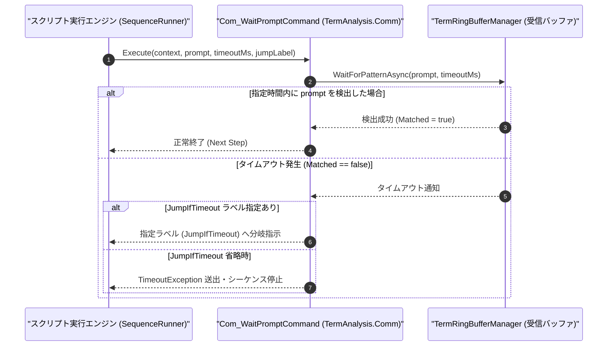

# コマンドリファレンス：Com_WaitPrompt

## 概要

**Com_WaitPrompt** は、COM ポート（UART）の非同期受信リングバッファ（`TermRingBufferManager`）を監視し、指定されたプロンプト文字列（または応答キーワード）が受信されるまで待機するコマンドです。
指定したタイムアウト時間内にプロンプトが受信されなかった場合、第 3 引数に指定したラベルへ自動的にジャンプ（分岐）させることができます。

> 💡 **補足**: ポーリングによる CPU 負荷を抑えた非同期イベント駆動で監視を行います。

---

## 💡 書式・パラメータ仕様

### コマンド構文

```csv
,SEQUENCE, [ステップキー], Com_WaitPrompt, "<Prompt>", "[TimeoutMs: 10000]", "[JumpIfTimeout]"
```

### パラメータ（引数）一覧

| 引数位置 | パラメータ名 | 必須/任意 | 型・制約 | 説明 |
| :---: | :--- | :---: | :--- | :--- |
| 第1引数 | `Prompt` | **必須** | 文字列 | 受信を待機するプロンプト文字列または応答パターン（例: `"READY>"`, `"OK"`, `"LOGIN:"`）を指定します。 |
| 第2引数 | `TimeoutMs` | 任意 | 整数（ミリ秒、既定値: `10000`） | 最大待機時間をミリ秒単位で指定します。省略時は `10000`（10秒）となります。 |
| 第3引数 | `JumpIfTimeout` | 任意 | ラベル名 / ステップ番号 | タイムアウト発生時にジャンプする遷移先ラベルを指定します。省略時はタイムアウト例外を送出して停止します。 |

---

## 🔄 特殊置換規約・分岐規約の適用

本コマンドの引数における特殊記法および解釈ルールです。
* **動的置換（`$`）**: 引数内で `$PARAMキー$` のように記述すると、実行時に変数プール（PARAM）の値へ動的置換されます。（適用可能な引数: 全引数対応）
* **ジャンプ先指定（`#`）**: タイムアウト発生時の遷移先ラベルを `#ラベル名#` の形式で指定できます。（適用可能な引数: `JumpIfTimeout` 引数）
* **共通コマンド指定（`@`）**: 本コマンドは外部マクロを呼び出さないため、共通コマンド呼び出し記法は適用されません。（適用可能な引数: 非適用）
* **カンマのエスケープ**: 通信条件文字列（例: `"9600,E,7,1"`）や複数データのカンマ区切り値を単一引数として渡す場合は、必ず `"..."` と二重引用符で囲んで記述します。
* **エイリアス（別名）**: `WaitPrompt`, `Term_WaitPrompt`, `Analysis_Term_WaitPrompt`, `WaitChar`, `Term_WaitChar`, `Analysis_Term_WaitChar`

---

## 💡 動作例（正しい構文での記述例）

### スクリプト記述例

※COMMAND ブロック配下の子要素行（PARAM, SEQUENCE）は必ず行頭カンマから開始し、スペースインデントや行末コメント（`;`）は記述しないでください。

```csv
COMMAND, "SAMPLE_COM_WAITPROMPT", ""
,PARAM, "RETRY_CNT", Text, "RETRY_CNT", "0"
,SEQUENCE, 010, Com_Open
,SEQUENCE, #SEND_RETRY#, Com_Send, "PING"
; 3秒以内に "PONG" が返らなければ TIMEOUT_HANDLE ラベルへ分岐
,SEQUENCE, 020, Com_WaitPrompt, "PONG", "3000", "TIMEOUT_HANDLE"
,SEQUENCE, 030, Msg_Box, "通信成功：PONGを受信しました"
,SEQUENCE, 040, Com_Close
,SEQUENCE, 050, Exit
,SEQUENCE, #TIMEOUT_HANDLE#, Param_Add, "$RETRY_CNT$", "1", "$RETRY_CNT$"
,SEQUENCE, 060, Judge, "$RETRY_CNT$", "<", "3", "SEND_RETRY"
,SEQUENCE, 070, Msg_Box, "通信タイムアウト：リトライ上限に達しました"
,SEQUENCE, 080, Com_Close
,SEQUENCE, 090, Exit
```

### 実行時の挙動・変数変化

* **実行前の状態**: Term 通信エンジンが初期化され、必要な通信パラメータおよび変数プール（`PARAM`）が準備されている状態。
* **実行後の状態**: `"PING"` 送信後、`Com_WaitPrompt` は最大 3,000ms の間 `"PONG"` の到着を待機します。 3,000ms 以内に `"PONG"` が受信されれば次の `Msg_Box` へ進みます。 タイムアウトした場合は `:TIMEOUT_HANDLE` へジャンプし、`$RETRY_CNT` を加算して最大 3 回まで再試行します。

---

## 🔄 動作フロー（シーケンス図）



---

## 🚫 エラーハンドリング・安全設計（仕様制限）

1. **空プロンプト指定の禁止**:
   - 第 1 引数 `Prompt` が空文字列の場合は、`ArgumentException` を送出して無条件通過による誤動作を防止します。
2. **キャンセル要求への即時応答**:
   - 待機中にユーザーが UI から「停止」ボタンを押した場合、`CancellationToken` により待機ループを即座に中断して安全に終了します。

---

## 🧪 ユニットテスト仕様

本コマンドクラス（`Com_WaitPromptCommand.cs`）に実装されている `RunUnitTest()` メソッドが検証するユニットテストの仕様です。

### テスト実行前提条件

* **実行トリガー**: `RunUnitTest()` メソッドの呼び出し
* **有効化条件**: システム全体の最小ログレベル（`ErrorLogger.MinimumLevel`）が `LogLevel.Test` であること（それ以外の場合は無効化ガードにより早期リターン）
* **検証結果出力**: `_log.LogTest` によるログ出力。検証失敗時は `_log.LogError`、予期せぬ例外発生時は `_log.LogCritical` で記録し、`finally` ブロックで `TermRingBufferManager.Instance.ClearBuffer()` および `UartTransportCore.Shared.IsLoopbackMode` の復元を実行します。

### テストケース一覧

| No | テストカテゴリ | テスト条件（入力値） | 期待される結果（出力値） | 検証の目的 / 観点 |
| :---: | :--- | :--- | :--- | :--- |
| **1** | 正常系 | `IsLoopbackMode = true` 環境下でプロンプト `"PROMPT_OK"`（`"READY>"`）と `"PROMPT_NG"`（`"ERROR#"`）を登録し、受信文字列 `"CMD ECHO\r\nOUTPUT LINE 1\r\nREADY>"` に対して `SearchPrompt` を `"PROMPT_OK"` / `"PROMPT_NG"` / `null` で実行 | `hitOk == true`、`hitNg == false`、`hitAny == true` が返却される | 登録プロンプト一致・不一致判定および任意登録プロンプト一括検索の検証 |
| **2** | 異常系 | 空データ `SearchPrompt(string.Empty, testCmd, "PROMPT_OK")` および `null` 入力 `SearchPrompt(null, null, null)` を指定して実行 | 例外を発生させず `emptyHit == false` かつ `nullHit == false` を安全に返却する | 空バッファおよび `null` 入力に対する境界値防御・クラッシュ防止の検証 |
